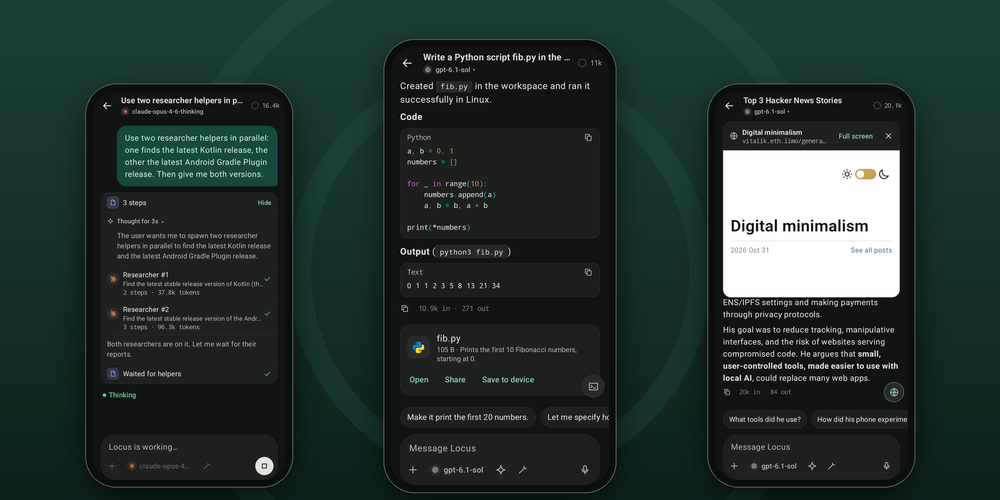
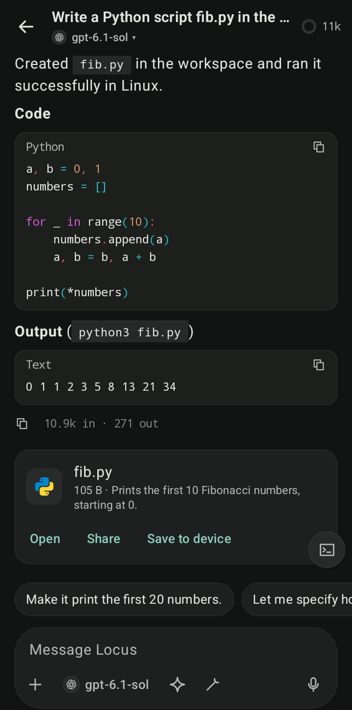
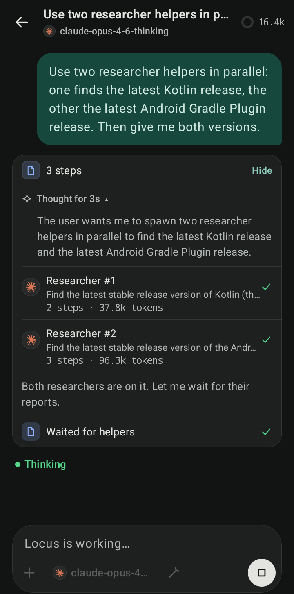
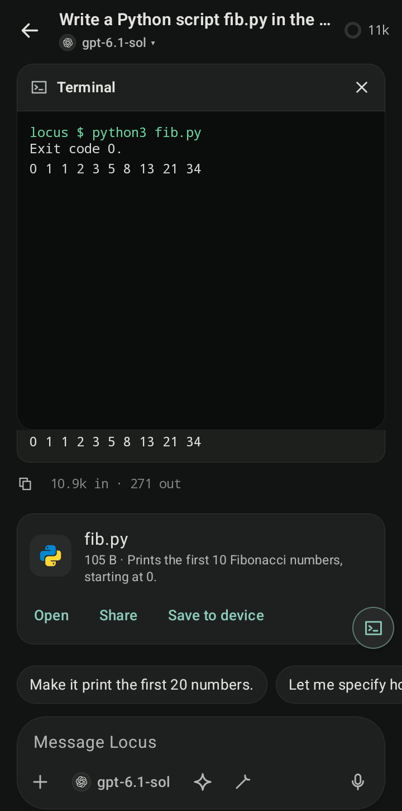
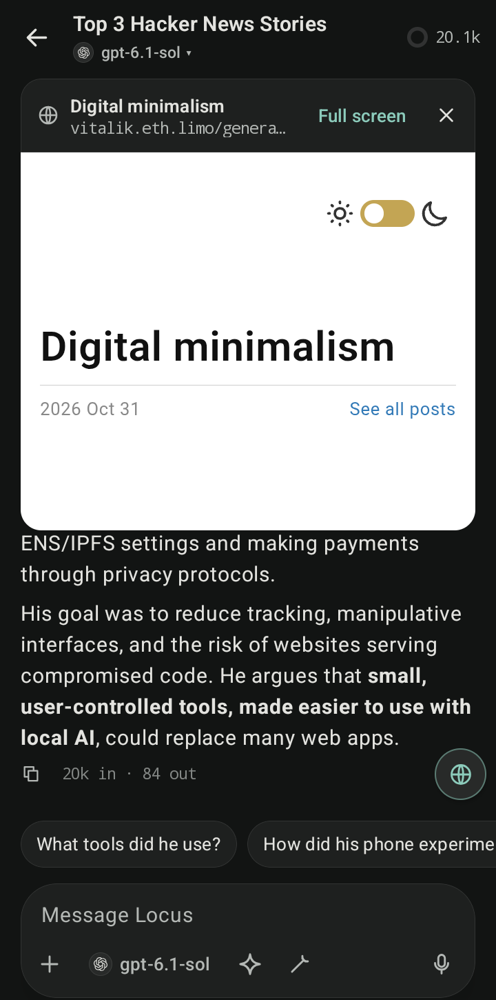
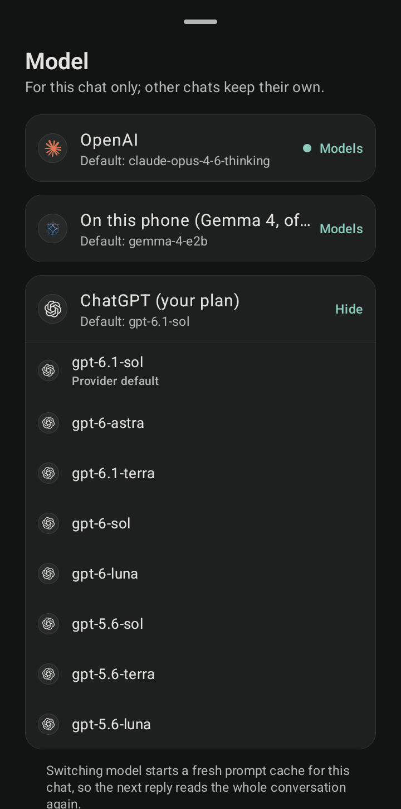
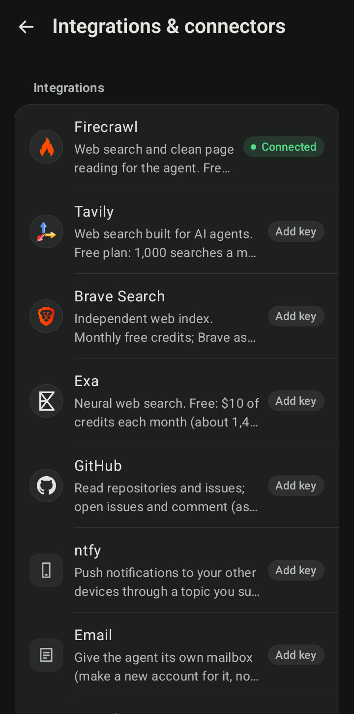
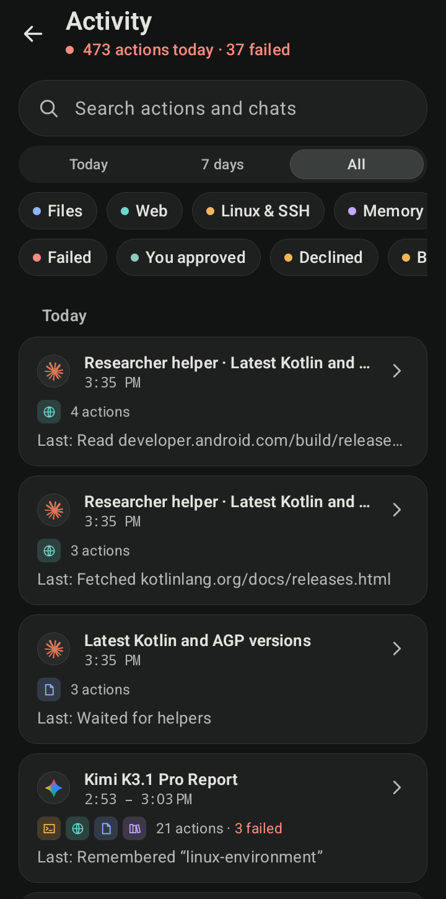
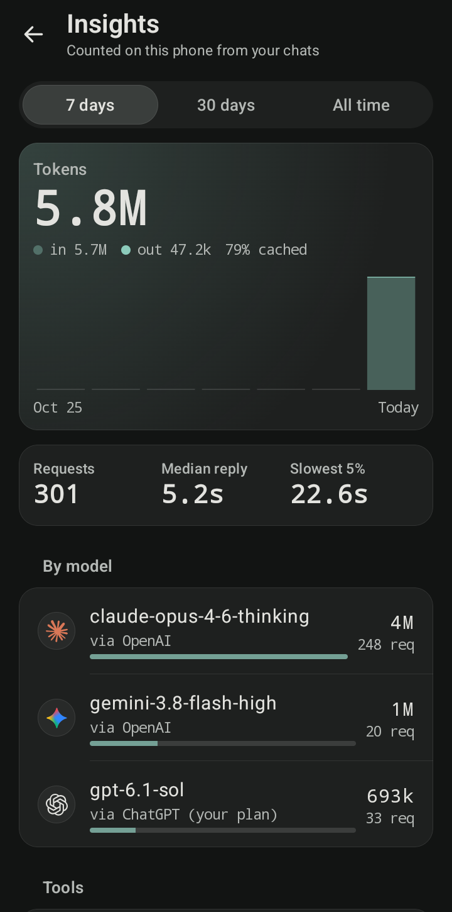
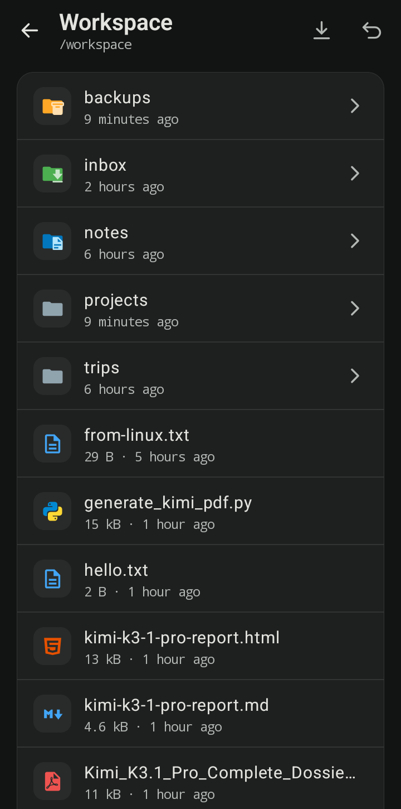

<div align="center">

[English](README.md) · **Español** · [Português (Brasil)](README.pt-BR.md) · [简体中文](README.zh-Hans.md)

  
  <h1>Locus</h1>

**Un agente de IA que vive en tu teléfono Android y trabaja con el modelo que elijas.**<br>
Usa tu propia clave, tu plan de ChatGPT, un servidor local o un modelo en el teléfono. Sin cuenta de Locus, sin servidor de Locus.

[](https://github.com/springmusk026/locus/actions/workflows/ci.yml)
[](https://github.com/springmusk026/locus/releases/latest)
[](LICENSE)
[-3DDC84?logo=android&logoColor=white)](#descarga-y-actualizaciones)

[](https://github.com/springmusk026/locus/releases/latest)
[](#descarga-y-actualizaciones)
[](https://github.com/sponsors/springmusk026)

[Descarga](#descarga-y-actualizaciones) · [Funciones](#funciones) · [Capturas](#capturas-de-pantalla) · [Seguridad](#modelo-de-seguridad-y-privacidad) · [Vídeo de lanzamiento](docs/media/locus-launch.mp4) · [Hoja de ruta](docs/ROADMAP.md) · [Preguntas frecuentes](#preguntas-frecuentes)

</div>

> [!NOTE]
> Esta es una traducción del [README en inglés](README.md). Si los dos difieren, la referencia es la versión en inglés.

<p align="center">
  
</p>

Locus le da a un modelo capaz manos en tu teléfono: una shell de Linux, un navegador que puedes observar, tus archivos, tu calendario y tus propios servidores. Planifica, trabaja a lo largo de muchos pasos y pregunta antes de cualquier cosa importante. Tus claves se guardan cifradas en el dispositivo, y las solicitudes van directamente al proveedor que elegiste, o a ninguna parte si el modelo se ejecuta en el teléfono.

> [!NOTE]
> Locus está en desarrollo activo, y la forma en que guarda los datos aún puede cambiar entre versiones. Este README describe `main`. Lo marcado como **(próximo)** ya está en `main` y aparece en [Unreleased del changelog](CHANGELOG.md#unreleased); todavía no está en la última versión publicada, y la mayor parte aún no se ha probado en un teléfono.

## Contenido

- [Por qué Locus](#por-qué-locus)
- [Funciones](#funciones)
- [Capturas de pantalla](#capturas-de-pantalla)
- [Descarga y actualizaciones](#descarga-y-actualizaciones)
- [Modelo de seguridad y privacidad](#modelo-de-seguridad-y-privacidad)
- [Proveedores y modelos compatibles](#proveedores-y-modelos-compatibles)
- [Compilar desde el código fuente](#compilar-desde-el-código-fuente)
- [Hoja de ruta](#hoja-de-ruta)
- [Preguntas frecuentes](#preguntas-frecuentes)
- [Contribuir](#contribuir)
- [Patrocinadores](#patrocinadores)
- [Historial de estrellas](#historial-de-estrellas)
- [Colaboradores](#colaboradores)
- [Agradecimientos](#agradecimientos)
- [Licencia](#licencia)

## Por qué Locus

- **Tu modelo, tus claves, sin intermediarios.** Anthropic, OpenAI, un plan de ChatGPT, cualquier servidor compatible con OpenAI o un modelo que se ejecuta en el teléfono. No hay cuenta ni servidor de Locus, ni analítica ni telemetría.
- **Un agente de verdad, no una caja de chat.** Una shell de Linux con Python, Node y git, un navegador que maneja mientras lo observas, SSH a tus máquinas, servidores MCP y conectores, ayudantes que trabajan en paralelo y un recibo de cada tarea.
- **Tú tienes el control.** Cada herramienta está en Permitir, Preguntar o Rechazar. Cuando una ejecución ha leído contenido externo, todo lo que pueda enviar datos fuera pregunta primero, y los secretos nunca llegan al modelo.
- **Hecho para un teléfono.** Modo de voz, widgets en la pantalla de inicio, un mosaico de ajustes rápidos, Direct Share, aprobaciones por Telegram, tareas en segundo plano que respetan el calor y la batería, y calendario, recordatorios y traspasos a tus otras apps. En inglés, español, portugués (Brasil) o chino simplificado.

## Funciones

### Modelos

- Claves de API de Anthropic y OpenAI, tu **plan ChatGPT Plus o Pro** con el inicio de sesión oficial de OpenAI, cualquier servidor compatible con OpenAI, **Gemma 4** en el teléfono con LiteRT-LM y modelos GGUF con llama.cpp ([GGUF en el dispositivo](docs/design/llamacpp.md)). Cambia de modelo en cada chat.
- Los modelos de respaldo y las claves de respaldo toman el relevo cuando un modelo se queda sin cuota, tiene límite de solicitudes o está sobrecargado ([respaldos](docs/design/fallbacks.md)). Locus comprueba las herramientas, la visión y la ventana de contexto de un modelo antes de darle trabajo, y explica por qué se omitió uno ([capacidades](docs/design/model-capabilities.md)).
- Control de costes: los recibos de cada tarea, los presupuestos y Estadísticas cuentan las lecturas y escrituras de caché y los resúmenes del servidor, y los chats largos se resumen antes del escalón de precio del modelo. El esfuerzo sigue el valor predeterminado de cada modelo ([coste](docs/design/cost.md)); **(próximo)** en los modelos actuales de Claude y GPT, cambiar el esfuerzo a mitad de un chat conserva la caché del prompt ([cambios a mitad de chat](docs/design/midchat-config.md)).
- **Comparar modelos (próximo):** envía un mensaje también a un segundo modelo y quédate con la respuesta que prefieras; el segundo modelo solo puede leer ([comparar modelos](docs/design/compare-models.md)). **Planificar con un modelo y ejecutar con otro (próximo)** en el modo plan ([plan y ejecución](docs/design/plan-run.md)).

### Agente

- Modo plan, una lista de tareas en vivo y ayudantes (subagentes) para investigar y trabajos secundarios, hasta tres a la vez ([subagentes](docs/design/subagents.md)).
- Las tareas largas no se quedan sin contexto: el trabajo se resume entre pasos cerca del límite de la ventana del modelo ([compactación](docs/design/compaction.md)). Guía una tarea en curso, haz una pregunta aparte con `/btw` o fija un presupuesto de tokens, coste y tiempo.
- Cada tarea terminada recibe un recibo: cómo terminó, cuánto tardó, archivos cambiados, comprobaciones superadas, aprobaciones y coste estimado ([recibos](docs/design/task-receipt.md)).
- Regenera una respuesta, edita un mensaje como una rama nueva o bifurca un chat desde cualquier punto ([ramas](docs/design/branching.md)). **Rebobinar hasta aquí (próximo)** también devuelve los archivos del espacio de trabajo que cambiaron los turnos posteriores, y **Resumir desde aquí (próximo)** acorta el resto de un chat con un resumen que puedes editar ([rebobinar](docs/design/rewind.md)).
- Memoria que puedes ver y editar, con búsqueda por relevancia en cualquier idioma, y habilidades y conectores que el agente redacta para que los apruebes ([búsqueda en memoria](docs/design/memory-search.md), [manifiestos de habilidades](docs/design/skill-manifests.md)). **(próximo)** Si quieres, aprueba cada cambio en la memoria, y deja que Ordenar te sugiera qué fusionar y qué quitar ([aprobación de memoria](docs/design/memory-approval.md)).
- **Chats temporales:** no leen ni guardan memoria, no aparecen en listas ni búsquedas, y se eliminan al salir de ellos ([chats temporales](docs/design/temporary-chats.md)).
- **Prompts guardados (próximo)** con huecos para rellenar, que eliges con `/` ([prompts guardados](docs/design/saved-prompts.md)). **Importa tus chats de ChatGPT y Claude (próximo)** desde su exportación de datos, leída en el teléfono ([importar](docs/design/import-chats.md)).

### Linux, archivos y código

- Una shell de Alpine Linux en el teléfono, sin root, que solo se instala si tú lo eliges, con una página de estado, reparación y una lista de paquetes ([instalación de Linux](docs/design/linux-setup.md), [estado](docs/design/linux-health.md)).
- Un terminal de verdad con pestañas y una fila de teclas extra ([terminal](docs/design/terminal.md)).
- Un espacio de trabajo que puedes abrir desde la app Archivos de Android, con visores para PDF, código, Markdown, tablas y multimedia. Una tarjeta bajo cada turno lista los archivos cambiados con sus diferencias y deshacer por archivo; las compilaciones y las pruebas aparecen como tarjetas de éxito o error ([seguimiento de cambios](docs/design/change-tracking.md)). El agente puede mirar las imágenes de su espacio de trabajo con un modelo con visión ([ver imágenes](docs/design/view-image.md)).
- **Carpetas conectadas:** dale al agente una bóveda de Obsidian o Logseq, una carpeta de Syncthing o cualquier carpeta mediante el selector de Android ([carpetas conectadas](docs/design/connected-folders.md)).
- Los gráficos, diagramas y pequeñas herramientas de una respuesta se ejecutan como vistas previas en vivo, en un entorno aislado sin red ni almacenamiento ([artefactos](docs/design/artifacts.md)). **Publica (próximo)** un artefacto o un chat como página web en tu propia cuenta de Netlify, Cloudflare o Vercel, después de quitarle los secretos ([publicar](docs/design/publish.md)).
- SSH a tus propios servidores, trabajos largos que sobreviven a las desconexiones y proyectos que ejecutan sus comandos en una de tus máquinas ([ejecución remota](docs/design/remote-execution.md)).

### Navegador

- Un navegador que el agente maneja mientras lo observas; los inicios de sesión, los pagos y el envío de formularios los confirmas tú ([navegador](docs/design/browser.md)).
- **Tomar control y devolver:** el agente espera y no ve nada hasta que le devuelves la página, si quieres con una nota ([tomar control](docs/design/browser.md#take-over-and-hand-back)).
- **Barra de direcciones, atrás, adelante y recargar** en el navegador a pantalla completa; un sitio que escribes ahí cuenta como uno que nombraste tú ([barra de direcciones](docs/design/browser.md#the-address-bar)).
- **Menús desplegables fiables:** menús personalizados, autocompletados y listas largas virtualizadas en MUI, Radix, react-select y sitios parecidos ([formularios y desplegables](docs/design/browser.md#forms-and-dropdowns)).
- **Señalar algo (próximo):** elige un botón, un enlace o una imagen de la página y adjúntalo a tu mensaje; **Ver la página (próximo)** muestra la página de un paso anterior del navegador tal como estaba ([selector de elementos](docs/design/browser.md#element-picker), [la página tal como estaba](docs/design/browser.md#the-page-as-it-was)).
- **Inicios de sesión guardados:** Locus rellena un usuario, una contraseña y un código de dos pasos guardados en el sitio exacto sin que el modelo los vea nunca, y ofrece guardar un inicio de sesión cuando entras tú mismo ([inicios de sesión guardados](docs/design/browser.md#saved-logins)).

### Conectores e integraciones

- Servidores MCP por HTTP (con OAuth) o ejecutándose localmente en Linux, y conectores HTTP con secretos de la bóveda ([conectores MCP](docs/design/mcp-connectors.md)).
- Búsqueda (Firecrawl, Tavily, Brave, Exa), GitHub, Vercel, Netlify, Cloudflare, Supabase, Render, correo, ntfy y Telegram. **(próximo)** Matrix, Gotify y webhooks como canales para avisos y resultados de tareas ([canales de aviso](docs/design/reach-me-channels.md)).
- **Tus propios servicios:** plantillas para Miniflux, FreshRSS, Paperless-ngx, Immich, Mastodon y Vikunja (y **Jellyfin (próximo)**), con Probar conexión, además de Home Assistant (los dispositivos de riesgo siempre preguntan), Todoist y Nextcloud ([integraciones](docs/design/integrations.md)).
- **Formulario de configuración de correo:** dirección y contraseña de aplicación, con los datos del servidor ya rellenados para los proveedores habituales y una prueba de conexión ([configuración de correo](docs/design/email-setup.md)).
- Los chats nuevos cargan las herramientas de uso diario y encuentran el resto cuando hace falta, con la búsqueda de herramientas propia de Anthropic y OpenAI donde existe ([descubrimiento de herramientas](docs/design/tool-discovery.md)).

### En el teléfono

- **Modo de voz:** una conversación manos libres con las mismas herramientas y aprobaciones, que usa los servicios de voz de Android y no guarda audio ([modo de voz](docs/design/voice-mode.md)).
- **Formas de entrar:** accesos directos del lanzador y de Direct Share, un mosaico de ajustes rápidos, "Preguntar a Locus" sobre texto seleccionado, el rol de asistente predeterminado e intents de automatización opcionales para Tasker y Automate ([puente con Android](docs/design/android-bridge.md)).
- **Widgets en la pantalla de inicio:** un widget de estado con lo que está haciendo Locus y el último resultado de una tarea programada (**(próximo)** también la siguiente ejecución, ajustado a su tamaño), y **(próximo)** un widget de uso con el gasto o los tokens de hoy y los últimos siete días ([widgets](docs/design/android-bridge.md#the-widget)).
- **Tu idioma:** las pantallas de Locus están en inglés, español, portugués (Brasil) y chino simplificado. Ajustes → Idioma elige uno solo para Locus (Android 13 y posteriores; los teléfonos más antiguos siguen el idioma del teléfono). Lo que lee el modelo sigue en inglés, y el modelo responde en el idioma en que le escribas ([localización](docs/design/localization.md)).
- **Calendario, recordatorios y traspasos:** crea, edita y elimina eventos en un calendario que eliges; recordatorios con posponer que sobreviven a un reinicio; contactos nuevos, Guardar como y portapapeles entregados al sistema contigo al tanto ([integraciones del teléfono](docs/design/phone-integrations.md)).
- **Control remoto por Telegram:** aprueba una solicitud en segundo plano desde el chat de tu bot, o inicia tareas escribiéndole. Desactivado de forma predeterminada ([Telegram](docs/design/telegram-remote.md)).

### Organizar el trabajo

- Los **proyectos** reúnen chats con su propia carpeta (los archivos que adjuntas en un chat del proyecto van a ella), instrucciones, memoria, permisos y modelo predeterminado, y una fila en el inicio muestra qué proyecto te necesita ([proyectos](docs/design/projects.md)). **(próximo)** Las reglas de proyecto ejecutan una comprobación después de las ediciones o antes de que el agente termine, o bloquean un comando ([reglas](docs/design/rules.md)), y una instantánea opcional te permite deshacer lo que cambió un comando de shell ([instantáneas de shell](docs/design/shell-snapshots.md)).
- **Flujos de trabajo:** guarda una tarea que salió bien y vuelve a ejecutarla con datos nuevos, cuando quieras o de forma programada. **Investigación (próximo)** viene incluida: los ayudantes buscan y leen fuentes, comprueban las afirmaciones clave y escriben un informe con citas ([flujos de trabajo](docs/design/workflows.md), [investigación](docs/design/deep-research.md)).
- **Tareas programadas:** ejecuciones de solo lectura en segundo plano que informan por notificación, ntfy o Telegram, cada cierto periodo o **(próximo)** a una hora del día ("todos los días a las 07:30"). Los **eventos** las inician cuando pasa algo: una entrada del calendario, un mensaje de ntfy, un correo nuevo u otra app, cada uno con su historial. **(próximo)** Abre el chat de una tarea en curso y envía un mensaje para tomar el control ([ejecuciones programadas](docs/design/scheduled-runs.md), [eventos](docs/design/event-triggers.md)).
- **Te necesita (próximo):** una sección en el inicio con cada aprobación, pregunta y pausa por presupuesto, y lo que las tareas programadas propusieron para que lo apruebes ([te necesita](docs/design/needs-you.md)).
- **Batería y calor:** el trabajo no urgente espera mientras el teléfono está caliente o en ahorro de batería ([batería y calor](docs/design/battery-thermal.md)).
- **Copia de seguridad cifrada y restauración** a un archivo que eliges, comprobada antes de reemplazar nada ([copia de seguridad](docs/design/backup.md)).
- **Inicio rápido:** configura un modelo y empieza; los pasos opcionales esperan como tarjetas en el inicio ([inicio rápido](docs/design/onboarding-quick-start.md)).

## Capturas de pantalla

<table>
  <tr>
    <td></td>
    <td></td>
    <td></td>
    <td></td>
  </tr>
  <tr>
    <td></td>
    <td></td>
    <td></td>
    <td></td>
  </tr>
  <tr>
    <td></td>
  </tr>
</table>

Las capturas muestran la interfaz en inglés.

## Descarga y actualizaciones

Descarga el último APK desde [**Releases**](https://github.com/springmusk026/locus/releases/latest). Locus necesita un teléfono de 64 bits con Android 8.0 o posterior.

| Archivo | Para |
|---|---|
| `locus-v<version>-arm64-v8a.apk` | Casi todos los teléfonos |
| `locus-v<version>-x86_64.apk` | Chromebooks x86_64 y emuladores |
| `SHA256SUMS.txt` | Sumas de comprobación de ambos |

La primera vez que lo abras, elige un modelo y toca **Inicio rápido**, o sigue la configuración completa para darle nombre a tu agente e instalar el espacio de trabajo de Linux.

**Mantenerse al día.** Elige una opción:

- **En la app:** activa **Buscar actualizaciones en GitHub** (en la configuración inicial, o en Ajustes → Acerca de y privacidad). Está desactivado de forma predeterminada. Locus consulta entonces a GitHub más o menos una vez al día con Wi-Fi, verifica un APK nuevo con `SHA256SUMS.txt` y con la clave de firma de la app instalada, y se lo pasa al instalador de Android para que lo confirmes. **Incluir versiones beta** ofrece también las versiones preliminares ([actualizaciones](docs/design/updates.md)).
- **Con [Obtainium](https://github.com/ImranR98/Obtainium):** añade `https://github.com/springmusk026/locus` como fuente de la app y, si te lo pide, filtra los APK con `arm64-v8a` (o `x86_64`). Si Locus se instaló con Obtainium, Locus le deja las actualizaciones a él.

**Comprobar una descarga.** La huella SHA-256 del certificado de la clave de publicación es

```
0fc4ab07aa5522dfabac92d818fd5cf075ead96da4e2b40a757ac80541490e1b
```

Compárala con `apksigner verify --print-certs <apk>`. Desde la 0.1.6, los APK publicados también llevan una atestación de procedencia de la compilación:

```sh
gh attestation verify locus-v<version>-arm64-v8a.apk --repo springmusk026/locus \
  --signer-workflow springmusk026/locus/.github/workflows/release.yml
```

Consulta [docs/RELEASING.md](docs/RELEASING.md) y [docs/FDROID.md](docs/FDROID.md) sobre las compilaciones reproducibles. F-Droid todavía no está disponible ([preguntas frecuentes](#preguntas-frecuentes)).

## Modelo de seguridad y privacidad

El modelo completo, incluido qué está aislado y qué no, está en [SECURITY.md](SECURITY.md).

- **Aprobaciones.** Cada herramienta está en Permitir, Preguntar o Rechazar, y un chat se puede limitar más (Solo lectura, Espacio de trabajo o Completo). Las aprobaciones llegan al chat o a una notificación que exige desbloquear el teléfono; un revisor opcional compara las acciones de nivel Preguntar con lo que pediste. **(próximo)** Mantén pulsado Rechazar para decirle al agente por qué ([aprobaciones recordadas](docs/design/remembered-approvals.md)).
- **Seguimiento de contaminación (taint).** Cuando una ejecución ha leído contenido externo (una página web, un correo, la salida de un comando), enviar cualquier cosa fuera, abrir un sitio que no nombraste y guardar en la memoria preguntan primero. Cuando ha leído tus propios datos, un sitio nuevo con cualquier cosa en su dirección también pregunta ([taint](docs/design/taint.md)).
- **Protección contra la inyección de prompts.** Los caracteres ocultos (etiquetas Unicode, controles bidi, secuencias de ancho cero) se eliminan de todo lo que lee el modelo; las herramientas MCP quedan fijadas y sus cambios necesitan tu revisión; los enlaces de las respuestas que podrían filtrar datos preguntan antes de abrirse.
- **Bloquear Locus y chats bloqueados (próximo).** Un bloqueo opcional pide tu huella, tu cara o el bloqueo de pantalla antes de que Locus muestre nada; un chat bloqueado pregunta antes de abrirse y nunca se nombra en listas, búsquedas, notificaciones ni accesos directos ([bloqueo de la app](docs/design/app-lock.md)).
- **Los secretos siguen siendo secretos.** Las claves de API, los tokens y los inicios de sesión guardados se cifran con Tink bajo una clave del Android Keystore, quedan fuera de las copias de seguridad salvo que los incluyas, y nunca se muestran al modelo. Las pantallas que muestran una clave o una contraseña bloquean las capturas de pantalla.
- **Sin telemetría.** Sin analítica, sin informes de fallos y sin servidor de Locus. Diagnóstico es un registro local, limpio de secretos, que solo sale si tocas Compartir ([diagnóstico](docs/design/diagnostics.md)). Las únicas solicitudes de red van a los proveedores y servicios que configuras; el catálogo de modelos (models.dev) y la búsqueda de actualizaciones están desactivados hasta que los actives.
- **Sin AccessibilityService.** Locus no puede leer ni controlar otras apps. Les pasa cosas, y tú confirmas allí.
- **Linux no es un entorno aislado.** Los comandos de Linux se ejecutan como el usuario de la propia app. Locus oculta sus procesos y sella sus ajustes frente a cambios desde Linux, pero trata los programas de Linux como código que decidiste ejecutar con los permisos de Locus ([aislamiento de Linux](docs/design/linux-isolation.md)).
- **Deshacer.** Actividad registra cada acción y se puede buscar en ella, y los archivos eliminados van a una papelera desde la que puedes restaurarlos.

¿Has encontrado una vulnerabilidad? [Infórmala en privado](https://github.com/springmusk026/locus/security/advisories/new), como explica [SECURITY.md](SECURITY.md).

## Proveedores y modelos compatibles

| Tipo | Qué funciona |
|---|---|
| Anthropic | Messages API con caché de prompts, compactación en el servidor y esfuerzo |
| OpenAI | Responses API con una clave de API, o un plan **ChatGPT Plus o Pro** con el inicio de sesión de OpenAI |
| Compatible con OpenAI | OpenRouter, Groq, Gemini, Ollama, LM Studio, vLLM y cualquier servidor que hable Chat Completions |
| En el teléfono | Gemma 4 E2B y E4B con LiteRT-LM; modelos GGUF con llama.cpp, desde una lista recomendada, la búsqueda de Hugging Face, una URL o un archivo |

Las listas de modelos se obtienen de cada proveedor. Los ajustes de red por proveedor cubren cabeceras adicionales, un proxy y certificados de CA personalizados ([red](docs/design/network.md)). Los resultados de las pruebas de rendimiento con un modelo real están en [docs/benchmarks](docs/benchmarks/README.md#results).

## Compilar desde el código fuente

Necesitas JDK 21 (sirve el que incluye Android Studio) y el SDK de Android.

```sh
git clone https://github.com/springmusk026/locus.git && cd locus
./gradlew :app:assembleDebug   # app/build/outputs/apk/debug/app-arm64-v8a-debug.apk (x86_64 too)
./gradlew unitTests lintDebug   # every module's JVM unit tests, and lint
```

Una compilación de depuración es una app aparte, `dev.locus.debug` ("Locus Debug"), así que se instala junto a Locus en lugar de sobre él. El espacio de trabajo de Linux usa binarios de proot precompilados de `core/linux/src/main/jniLibs`; `tools/build-proot.sh` los vuelve a compilar a partir de fuentes fijadas con el NDK r29.

Locus está hecho con Kotlin, Jetpack Compose y MVVM en 26 módulos de Gradle.

- [docs/ARCHITECTURE.md](docs/ARCHITECTURE.md): el diseño y por qué se eligió cada biblioteca
- [docs/STATE.md](docs/STATE.md): qué está hecho, qué está probado y qué viene después
- [docs/TESTING.md](docs/TESTING.md): las pruebas unitarias, de capturas, de instrumentación y de rendimiento; la CI también ejecuta detekt y un mínimo de cobertura con Kover ([CONTRIBUTING.md](CONTRIBUTING.md#static-analysis-and-coverage))
- [docs/design/](docs/design/): una nota por función, con la investigación que hay detrás
- [Traducciones](CONTRIBUTING.md#translations): dónde están los textos y cómo comprobarlos

La documentación del proyecto está en inglés.

## Hoja de ruta

Prioridades a corto plazo, según [docs/ROADMAP.md](docs/ROADMAP.md):

- **Los errores de la revisión de código de noviembre**, y luego **pruebas en el teléfono** de todo lo marcado como "aún no probado en el teléfono" en [STATE.md](docs/STATE.md#tested-on-the-phone-vs-not-yet), incluidas las pantallas traducidas.
- **Distribución:** volver a enviarlo a F-Droid cuando Locus cumpla su requisito de antigüedad; Google Play está investigado pero no empezado.
- **Más modelos locales:** chats GGUF más rápidos (una caché KV guardada, descarga a la GPU), entrada de imágenes para modelos GGUF y Gemini Nano donde esté disponible.
- **Proveedores:** un adaptador nativo para Gemini, y rutas para Bedrock, Vertex y Azure OpenAI.
- **Pruebas de rendimiento más difíciles**, para que el conjunto pueda ordenar los modelos actuales.
- **Un aislamiento de Linux más fuerte**, investigado en [aislamiento de Linux](docs/design/linux-isolation.md).

## Preguntas frecuentes

<details>
<summary><strong>¿Cuánto cuesta?</strong></summary>

Locus es gratis. Pagas directamente a tu proveedor de modelos por lo que uses, a sus precios, o nada si usas un plan de ChatGPT que ya tienes, tu propio servidor o un modelo en el dispositivo. Los recibos, los presupuestos de tarea y Estadísticas muestran el gasto estimado por tarea y por modelo.
</details>

<details>
<summary><strong>¿Qué sale de mi teléfono?</strong></summary>

Solo las solicitudes a los proveedores y servicios que configures. No hay servidor de Locus ni telemetría. La búsqueda de actualizaciones y el catálogo de models.dev están desactivados hasta que los actives. Consulta el [modelo de seguridad y privacidad](#modelo-de-seguridad-y-privacidad).
</details>

<details>
<summary><strong>¿Necesito root?</strong></summary>

No. El espacio de trabajo de Linux ejecuta Alpine Linux con proot como una app normal, y Locus no usa ningún AccessibilityService.
</details>

<details>
<summary><strong>¿Está Locus en F-Droid o Google Play?</strong></summary>

Todavía no. Las versiones publicadas se pueden reproducir byte a byte y coinciden con sus APK, y se hizo un envío a F-Droid, pero se cerró porque el proyecto es demasiado nuevo. Se volverá a enviar cuando Locus cumpla ese requisito ([docs/FDROID.md](docs/FDROID.md)). Google Play está investigado pero no empezado. Mientras tanto, usa [las versiones de GitHub u Obtainium](#descarga-y-actualizaciones).
</details>

<details>
<summary><strong>¿Cómo funciona el espacio de trabajo de Linux?</strong></summary>

Es un sistema de archivos raíz de Alpine Linux que se ejecuta con proot y que solo se descarga cuando decides instalarlo. Tienes `apk`, Python, Node y git, un terminal y una página de estado con reparaciones. Comparte el usuario de la app Locus, así que no es una frontera de seguridad ([instalación de Linux](docs/design/linux-setup.md), [aislamiento](docs/design/linux-isolation.md)).
</details>

<details>
<summary><strong>¿En qué idiomas está?</strong></summary>

La app está en inglés, español, portugués (Brasil) y chino simplificado; elige uno en Ajustes → Idioma en Android 13 y posteriores. Las traducciones se hicieron con ayuda de IA y se revisaron en cuanto a sentido y coherencia, pero todavía no las ha revisado ningún hablante nativo, así que las correcciones son bienvenidas ([CONTRIBUTING.md](CONTRIBUTING.md#translations)). El modelo responde en el idioma en que le escribas.
</details>

<details>
<summary><strong>¿Funciona sin internet?</strong></summary>

Sí, con un modelo en el dispositivo: Gemma 4 con LiteRT-LM o un modelo GGUF con llama.cpp. Los modelos pequeños son más lentos y menos capaces con las herramientas que los grandes alojados, y necesitan un teléfono con memoria suficiente; Locus avisa antes de usar un modelo demasiado grande.
</details>

## Contribuir

Los informes de errores y las ideas son bienvenidos en [Issues](https://github.com/springmusk026/locus/issues/new/choose). Para código, lee [CONTRIBUTING.md](CONTRIBUTING.md) y abre un issue antes de cualquier cosa grande. Las preguntas van a [SUPPORT.md](SUPPORT.md), y se espera que todo el mundo siga el [Código de conducta](CODE_OF_CONDUCT.md).

## Patrocinadores

Locus lo desarrolla en abierto una sola persona. El patrocinio paga dispositivos para probar, tiempo de API de modelos para las pruebas de rendimiento y tiempo para mantenerlo libre de anuncios y rastreo.

- **[GitHub Sponsors](https://github.com/sponsors/springmusk026)**: una vez o cada mes.
<!-- TODO(owner): add crypto wallet addresses here (one line per coin, with the network), and the same links under `custom:` in .github/FUNDING.yml if wanted. Until then, no addresses are published anywhere. Restore this line with them:
- **Cripto:** ...
-->

### Patrocinadores destacados

Las organizaciones que patrocinan Locus pueden tener su logotipo aquí. Ponte en contacto a través de [GitHub Sponsors](https://github.com/sponsors/springmusk026).

<!-- TODO(owner): add sponsor logos here, each linked to the sponsor's site, for example:
<p align="center">
  <a href="https://example.org"></a>
</p>
-->

### Proveedor destacado

Los proveedores de IA pueden patrocinar Locus como proveedor destacado. Locus sigue siendo neutral y de "trae tu propia clave":

- Un proveedor destacado solo aparecería como una entrada opcional y claramente etiquetada en el selector de proveedores o en la configuración inicial, junto a todos los demás proveedores.
- No se añade rastreo, avisos de referidos ni analítica, y las garantías de privacidad de Locus no cambian.
- Locus nunca cambia el proveedor ni el modelo predeterminado de nadie, y todos los proveedores siguen funcionando igual.

Hoy no existe ninguna entrada así en la app. Los proveedores interesados pueden ponerse en contacto a través de [GitHub Sponsors](https://github.com/sponsors/springmusk026).

## Historial de estrellas

<a href="https://www.star-history.com/#springmusk026/locus&Date">
  <picture>
    <source media="(prefers-color-scheme: dark)" srcset="https://api.star-history.com/svg?repos=springmusk026/locus&type=Date&theme=dark" />
    <source media="(prefers-color-scheme: light)" srcset="https://api.star-history.com/svg?repos=springmusk026/locus&type=Date" />
    
  </picture>
</a>

## Colaboradores

<a href="https://github.com/springmusk026/locus/graphs/contributors">
  
</a>

## Agradecimientos

Locus se apoya en mucho trabajo de código abierto. Gracias a las personas que hay detrás de:

| Proyecto | Para qué se usa | Licencia |
|---|---|---|
| [Kotlin](https://kotlinlang.org), [kotlinx.coroutines](https://github.com/Kotlin/kotlinx.coroutines), [kotlinx.serialization](https://github.com/Kotlin/kotlinx.serialization) | El lenguaje y sus bibliotecas básicas | Apache-2.0 |
| [Android Jetpack](https://developer.android.com/jetpack) (Compose, Material 3, Room, WorkManager, DataStore, Navigation 3, Glance, WebKit, JavaScriptEngine) y [Hilt](https://dagger.dev/hilt/) | Interfaz, almacenamiento, trabajo en segundo plano, el navegador y el entorno aislado de scripts | Apache-2.0 |
| [Ktor](https://ktor.io) | Cliente HTTP para todos los proveedores | Apache-2.0 |
| [Tink](https://github.com/tink-crypto/tink-java) | La bóveda cifrada y las copias de seguridad | Apache-2.0 |
| [LiteRT-LM](https://github.com/google-ai-edge/LiteRT-LM) | Gemma en el teléfono | Apache-2.0 |
| [llama.cpp](https://github.com/ggml-org/llama.cpp) | Modelos GGUF en el teléfono | MIT |
| [MCP Kotlin SDK](https://github.com/modelcontextprotocol/kotlin-sdk) | Conectores MCP | Apache-2.0 (antes MIT) |
| [ConnectBot sshlib](https://github.com/connectbot/sshlib) | SSH y SFTP | Apache-2.0 |
| [Eclipse Angus Mail](https://github.com/eclipse-ee4j/angus-mail) | Correo por IMAP y SMTP | EPL-2.0 o GPL-2.0 con Classpath Exception |
| [jsoup](https://jsoup.org) | Leer páginas web | MIT |
| [Multiplatform Markdown Renderer](https://github.com/mikepenz/multiplatform-markdown-renderer), [LaTeX renderer](https://github.com/huarangmeng/latex), [Mermaid](https://mermaid.js.org) | Mostrar respuestas, fórmulas y diagramas | Apache-2.0, MIT, MIT |
| [Termux terminal-emulator y terminal-view](https://github.com/termux/termux-app) | El terminal | Apache-2.0 |
| [PRoot](https://github.com/termux/proot), [talloc](https://talloc.samba.org), [Alpine Linux](https://alpinelinux.org) | El espacio de trabajo de Linux | GPL-2.0-or-later, LGPL-3.0-or-later, según el paquete |
| [LobeHub Icons](https://github.com/lobehub/lobe-icons), [Simple Icons](https://github.com/simple-icons/simple-icons), [Material Icon Theme](https://github.com/material-extensions/vscode-material-icon-theme) | Iconos de proveedores, servicios y tipos de archivo | MIT, CC0-1.0, MIT |
| [models.dev](https://models.dev) | El catálogo opcional de modelos (un servicio en línea, desactivado de forma predeterminada) | n/a |
| [Roborazzi](https://github.com/takahirom/roborazzi), [Robolectric](https://robolectric.org), [Turbine](https://github.com/cashapp/turbine), [GreenMail](https://greenmail-mail-test.github.io/greenmail/), [Kover](https://github.com/Kotlin/kotlinx-kover), [detekt](https://detekt.dev), [Compose Rules](https://github.com/mrmans0n/compose-rules) | Pruebas, cobertura y análisis estático | Apache-2.0, MIT, Apache-2.0, Apache-2.0, Apache-2.0, Apache-2.0, Apache-2.0 |

El código de terceros incluido conserva su propia licencia; los detalles están en [core/linux/NOTICE](core/linux/NOTICE), [core/terminal/NOTICE](core/terminal/NOTICE), [core/designsystem/NOTICE.md](core/designsystem/NOTICE.md) y [core/markdown/NOTICE.md](core/markdown/NOTICE.md). Los nombres y logotipos de productos pertenecen a sus propietarios y solo identifican el servicio que conectas.

## Licencia

Locus se distribuye bajo la [GNU Affero General Public License v3.0 o posterior](LICENSE). Si distribuyes un Locus modificado o lo ofreces a través de una red, debes compartir su código fuente bajo la misma licencia.
