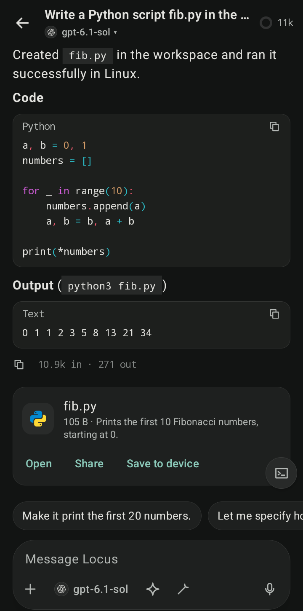
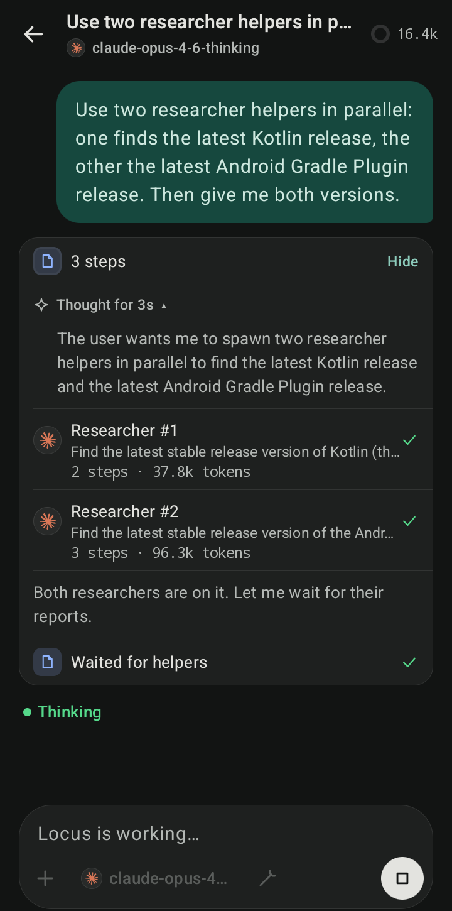
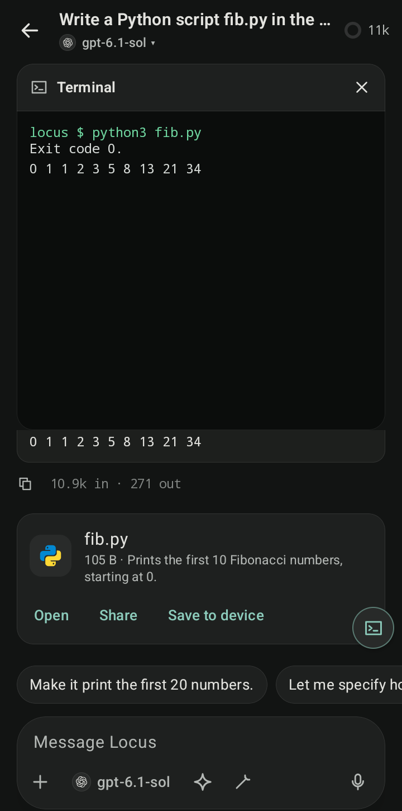
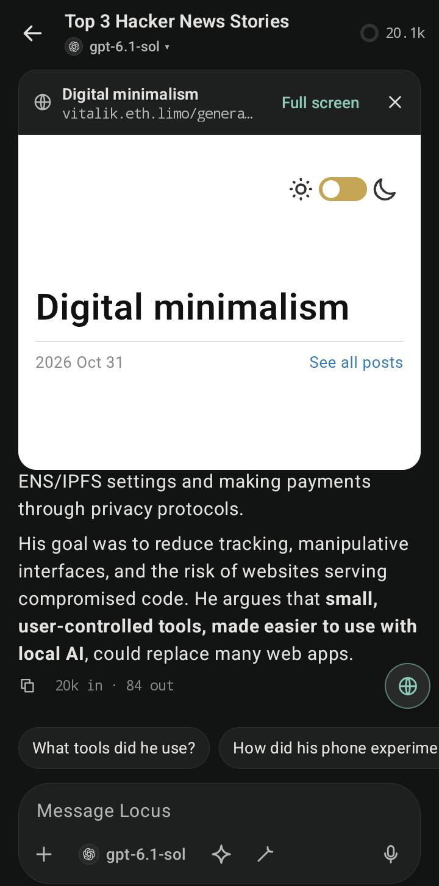
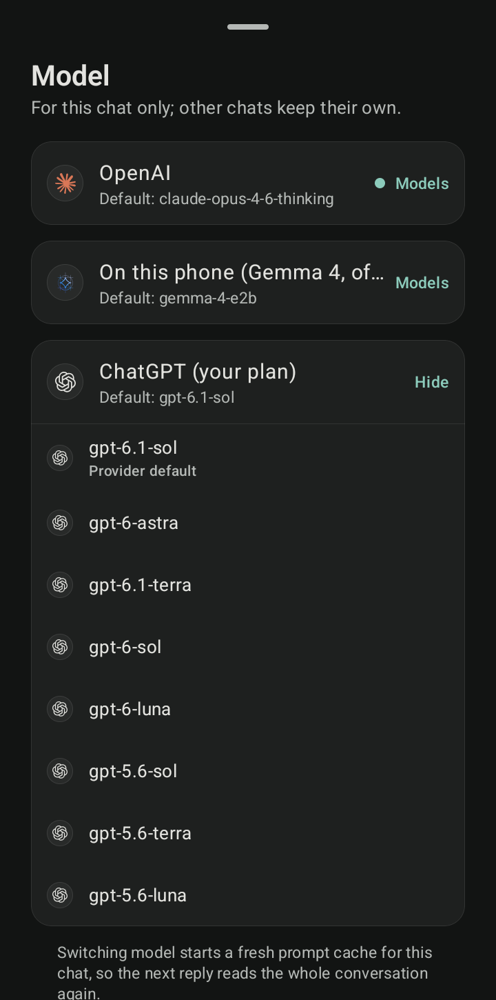
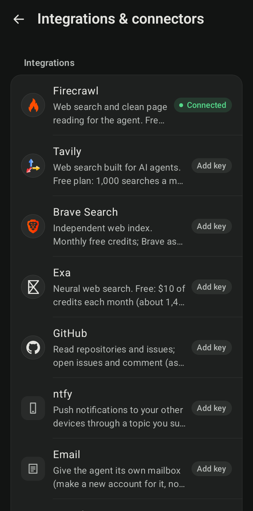
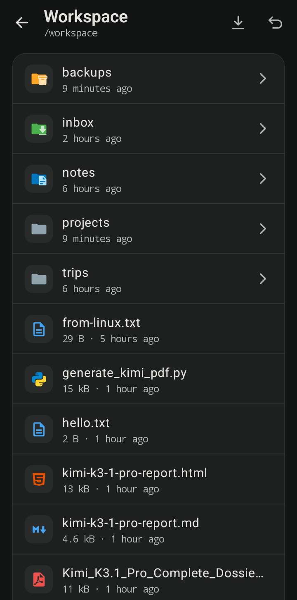
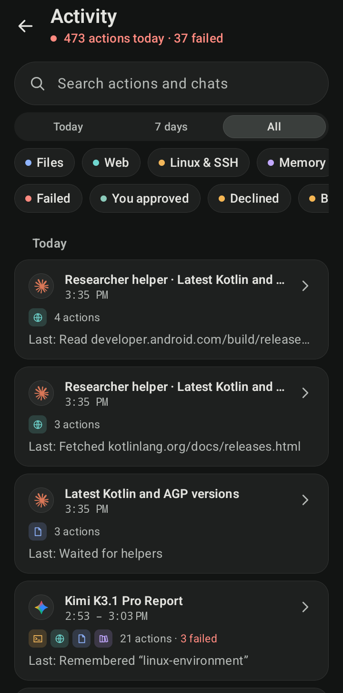
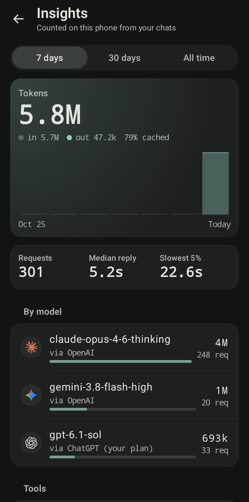

<div align="center">

# Locus

**A local-first AI agent for Android. Bring your own model; keep your data on your phone.**

[](https://github.com/springmusk026/locus/actions/workflows/ci.yml)
[](LICENSE)


</div>

An open-source AI agent that lives on your Android phone. You bring the model: your own API key, your ChatGPT plan, a model server on your network, or Gemma running fully on the phone. Locus does the rest locally. It plans, uses tools, works in its own Linux workspace, browses the web while you watch, and asks before it changes anything.

No account, no Locus server, no telemetry. Requests go straight from the phone to the provider you choose.

> **Status:** active development. The core logic is covered by unit tests, and the main flows are tried on a real phone (Galaxy S25 Ultra, Android 17). See [docs/STATE.md](docs/STATE.md) for exactly what's built, what's tested and what's next.

## Screenshots

<table>
  <tr>
    <td></td>
    <td></td>
    <td></td>
  </tr>
  <tr>
    <td align="center">Code, output and files</td>
    <td align="center">Sub-agents in parallel</td>
    <td align="center">Live Linux terminal</td>
  </tr>
  <tr>
    <td></td>
    <td></td>
    <td></td>
  </tr>
  <tr>
    <td align="center">Browser you can watch</td>
    <td align="center">Any model, per chat</td>
    <td align="center">Integrations</td>
  </tr>
  <tr>
    <td></td>
    <td></td>
    <td></td>
  </tr>
  <tr>
    <td align="center">Workspace</td>
    <td align="center">Activity</td>
    <td align="center">Insights</td>
  </tr>
</table>

## What it does

**Models**
- Anthropic (Claude), OpenAI (Responses API), and any OpenAI-compatible server: OpenRouter, Groq, Google Gemini (AI Studio key), Ollama, LM Studio, llama.cpp, vLLM.
- **Continue with ChatGPT:** use your ChatGPT Plus or Pro plan through OpenAI's official Sign in with ChatGPT program. No API key needed.
- **On-device:** Gemma 4 through LiteRT-LM, with image input and no network at all.
- Model lists are fetched for you. You can choose the thinking level per chat. A cheaper "helper model" can write titles, suggestions and summaries.

**Agent**
- Works across many steps with tools. Plan mode proposes a plan for you to approve first. A live todo list shows progress.
- **Sub-agents:** hands focused jobs (research, coding, exploring files, server checks) to helpers that run in parallel. You can open each helper's transcript.
- Remembers your preferences across chats. You can see, edit or forget everything it remembers.
- Writes its own skills (Agent Skills format) and API connectors, and waits for your approval before using them.
- Compacts long chats automatically. Shows tokens, cache use and context size.

**Tools**
- **Linux workspace:** Alpine Linux on the phone without root, with `apk`, Python, git and Node. Dev servers can be previewed in the browser.
- **Browser:** an in-app browser the agent drives while you watch. Take over at any time. Logins, payments and submits ask first.
- **Your servers:** SSH and SFTP with pinned host keys, plus long jobs that survive disconnects.
- **MCP servers** (with OAuth sign-in) and HTTP connectors. Their keys stay in an encrypted vault the model never sees.
- **Integrations:** Firecrawl, Tavily, Brave and Exa for search; GitHub; Vercel, Netlify and Cloudflare for deploys; email; ntfy push.
- **Phone actions** through standard Android intents (calendar, alarms, drafts, directions). The other app opens prefilled and you confirm there.
- **Files:** a workspace visible in Android's Files app, with viewers for PDF, images, code (highlighted), Markdown, tables and media. The agent can send files to you in the chat.

**You stay in control**
- Each tool has an Allow, Ask or Deny policy. Approvals happen in the chat, or from a notification that needs the phone unlocked.
- An optional safety reviewer (off by default) checks actions against what you actually asked for.
- Activity shows every action, grouped into runs, with search and filters. Insights shows tokens, speed and tool success.
- Deleted and overwritten files go to a trash you can restore from.
- Scheduled tasks run in read-only mode.
- Keys are encrypted with Tink (AES-256-GCM) under an Android Keystore key and are never included in backups.
- No AccessibilityService, by design: Locus never reads or operates other apps.

## Install

There are no published releases yet. Build it from source (below), or download a debug APK from CI: open the latest successful run under [Actions](https://github.com/springmusk026/locus/actions/workflows/ci.yml) and download the `locus-debug-apk` artifact (requires a GitHub login).

On first launch, the setup guide walks you through choosing a model, naming your agent, setting up the Linux workspace and connecting anything else you want.

## Build

Requirements: JDK 21 (Android Studio's bundled JDK works) and the Android SDK. Gradle installs the API 37 platform if it's missing. The app supports Android 8.0 (API 26) and up.

```sh
./gradlew :app:assembleDebug        # app/build/outputs/apk/debug/app-debug.apk
./gradlew testDebugUnitTest :core:agent:test :core:llm:test :core:model:test   # unit tests
./gradlew lintDebug                 # Android lint
./gradlew :app:assembleRelease      # R8-minified, signed with the debug key for local installs
```

The Linux workspace uses prebuilt proot binaries in `core/linux/src/main/jniLibs`. To rebuild them from the pinned sources (requires Android NDK r29):

```sh
tools/build-proot.sh
```

## How it's built

Kotlin, Jetpack Compose and MVVM, following Google's [architecture recommendations](https://developer.android.com/topic/architecture/recommendations). [docs/ARCHITECTURE.md](docs/ARCHITECTURE.md) explains the modules and records why each library was chosen, with sources.

```
app                  Activity, Navigation 3, Hilt application, share target
feature/chat         Home, chat, composer, live terminal/browser panel, sub-agent rows
feature/onboarding   First-run setup and the agent persona questionnaire
feature/settings     Settings hub: models, permissions, integrations, SSH, about
feature/workspace    File browser and viewers, import/export, trash
feature/activity     Runs, search and filters over every tool call
feature/analytics    Insights: tokens, speed, tools, approvals
feature/browser      Full-screen live browser and takeover
feature/library      Memory, skills, connectors and helper agents
feature/tasks        Scheduled tasks
core/data            Repositories, AgentRunner, foreground service, sign-ins, DocumentsProvider
core/database        Room: conversations, messages, audit log
core/datastore       Settings and encrypted secrets (DataStore + Tink)
core/agent           Agent loop, policies, reviewer, sub-agents, tools (pure Kotlin)
core/llm             Provider adapters over HTTP + SSE (pure Kotlin)
core/ondevice        On-device models (LiteRT-LM)
core/browser         Agent WebView, page script, browser tools
core/linux           Alpine-under-proot environment
core/model           Shared data types (pure Kotlin)
core/designsystem    Theme, components, logos and file icons
```

More docs:
- [docs/STATE.md](docs/STATE.md): where the project stands.
- [docs/ROADMAP.md](docs/ROADMAP.md): the full feature history and what's planned.
- [docs/design/](docs/design/): design notes for larger features.

## Contributing

Issues and pull requests are welcome. Read [CONTRIBUTING.md](CONTRIBUTING.md) first. To report a security problem, follow [SECURITY.md](SECURITY.md) instead of opening a public issue.

## License

Locus is free software under the [GNU Affero General Public License v3.0 or later](LICENSE) (AGPL-3.0-or-later). You may use, study, change and share it. If you distribute a modified version, or let people use one over a network, you must publish its source under the same licence.

Third-party assets and binaries keep their own licences:
- [core/linux/NOTICE](core/linux/NOTICE): PRoot (GPL-2.0-or-later) and talloc (LGPL-3.0-or-later).
- [core/designsystem/NOTICE.md](core/designsystem/NOTICE.md): LobeHub Icons and Material Icon Theme (MIT).

Product names and logos belong to their owners, and are used only to identify the provider or service you configured.
