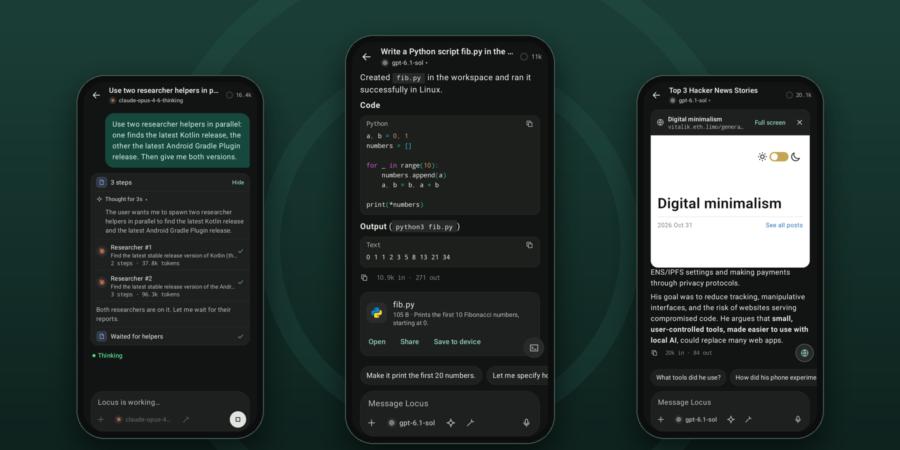
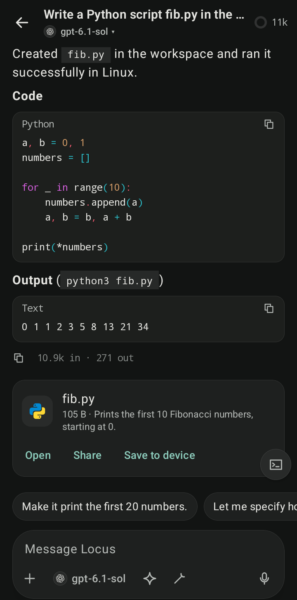
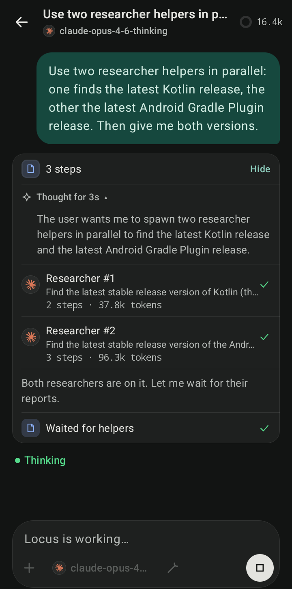
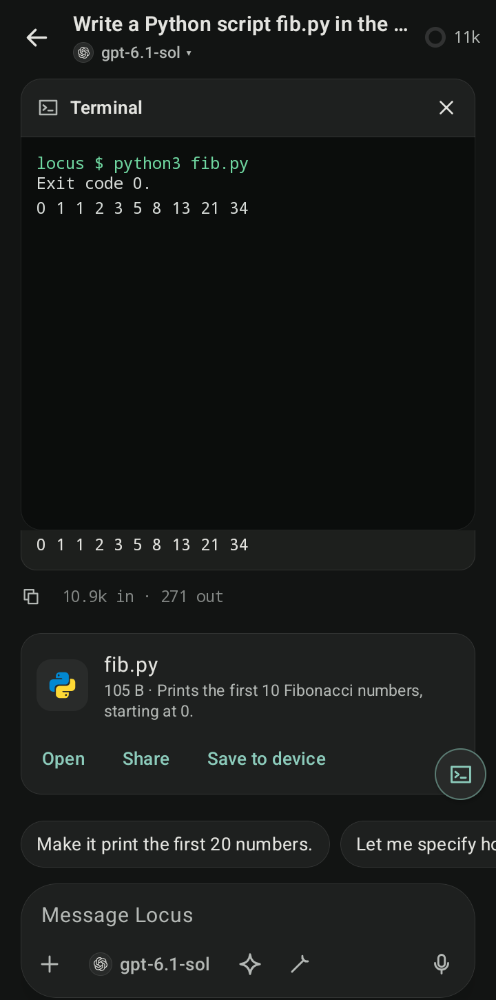
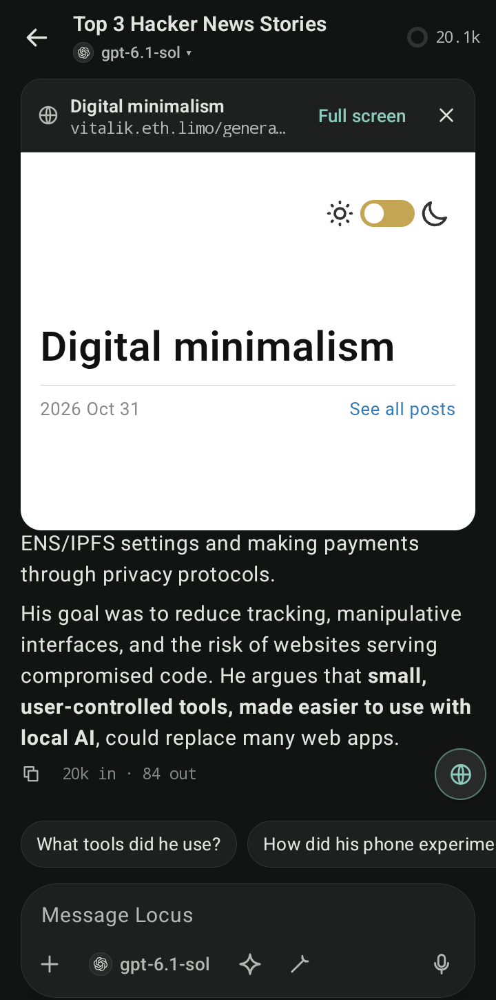
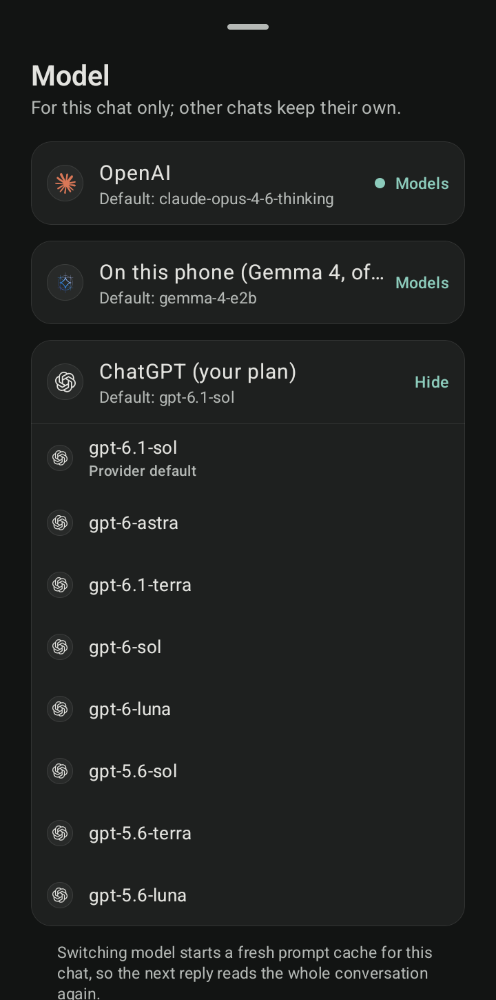
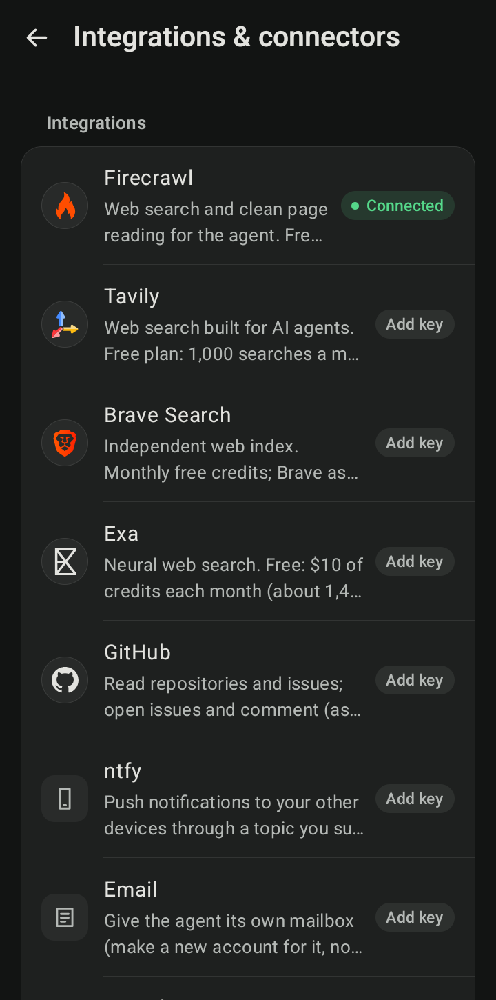
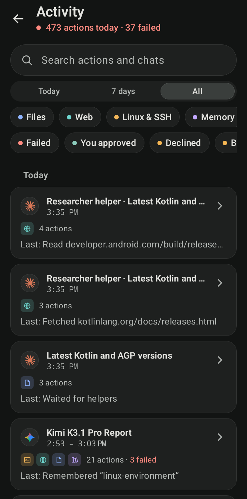
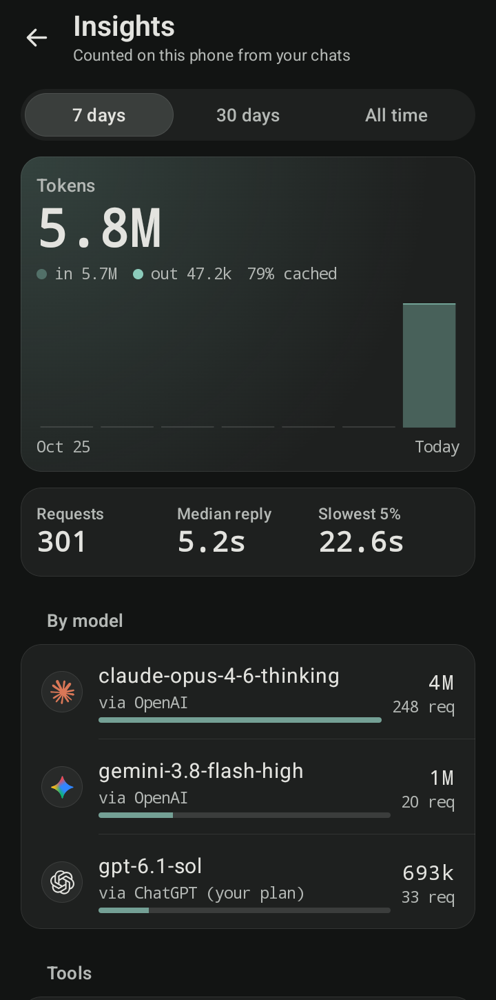
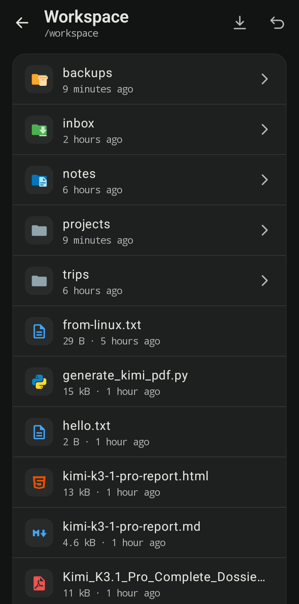

<div align="center">
  
  <h1>Locus</h1>

An AI agent that lives on your Android phone and works with the model you choose.

[](https://github.com/springmusk026/locus/actions/workflows/ci.yml)
[](https://github.com/springmusk026/locus/releases)
[](LICENSE)


[Download](#download) · [What it does](#what-it-does) · [Safety model](#safety-model) · [Screenshots](#screenshots) · [▶ Launch video](docs/media/locus-launch.mp4) · [Build](#build-from-source) · [Roadmap](docs/ROADMAP.md)

</div>

<p align="center">
  
</p>

Locus gives a capable model hands on your phone: a Linux shell, a browser you can watch, your files, your servers. It plans, works through many steps and asks before anything that matters. There's no Locus account and no Locus server. Your keys stay encrypted on the device, and requests go straight to the provider you picked, or nowhere at all if you run the model on the phone.

## Download

Grab the latest release from [**Releases**](https://github.com/springmusk026/locus/releases) and open it on a phone running Android 8.0 or newer. There's one APK per ABI: `locus-v<version>-arm64-v8a.apk` is the one for nearly every phone, and `locus-v<version>-x86_64.apk` is for x86_64 Chromebooks and emulators. Locus needs a 64-bit device. `SHA256SUMS.txt` lists the checksums.

**Staying up to date.** Either:
- Turn on **Check GitHub for new versions** (in setup, or Settings → About & privacy). It's off by default. When it's on, Locus asks GitHub about once a day on Wi-Fi; when there's a newer release it shows the notes, downloads the APK for your phone, checks it against `SHA256SUMS.txt` and the installed app's signing key, and hands it to Android's installer for you to confirm. **Check now** works with it off. See [docs/design/updates.md](docs/design/updates.md).
- Or track releases with [Obtainium](https://github.com/ImranR98/Obtainium): add `https://github.com/springmusk026/locus` as a GitHub source, and if it asks which APK, filter with `arm64-v8a` (or `x86_64`). When Obtainium installed Locus, Locus leaves updates to it.

> [!NOTE]
> Locus is in active development, and the way data is stored can still change between versions.
On first launch a short setup walks you through choosing a model, naming your agent and, if you want it, installing the Linux workspace.

## What it does

**Bring any model.** Use an Anthropic or OpenAI API key, any OpenAI-compatible server (OpenRouter, Groq, Gemini, Ollama, LM Studio, vLLM), your **ChatGPT Plus or Pro plan** through OpenAI's official sign-in, or **Gemma 4 running entirely on the phone**. Switch models per chat.
- Backup models and backup keys: when a model is out of quota, rate limited or overloaded, the next one on your list answers; when a key runs out, the next key takes over.
- Locus checks what a model can do (tools, vision, context window) before routing a chat, a helper or a backup to it, and says why one was skipped.

**Real tools, not a demo:**
- An Alpine Linux shell on the phone, no root needed, with Python, Node and git a command away
- A browser the agent drives while you watch, with logins, payments and form submits always confirmed by you
- SSH to your own servers, including long jobs that survive disconnects. A project can run its commands on one of your machines, with files synced over SFTP and approvals kept on the phone
- MCP servers, HTTP connectors, and integrations for search (Firecrawl, Tavily, Brave, Exa), GitHub, Vercel, Netlify, Cloudflare, Supabase, Render, email, and notifications through ntfy or your own Telegram bot
- A workspace you can open from Android's Files app, with viewers for PDF, code, Markdown, tables and media
- New chats load the everyday tools and find the rest when they need them, with Anthropic's and OpenAI's own tool search where the model has it

**Works like an agent.** It plans before acting when you ask, keeps a live checklist, hands research and side jobs to helpers that run in parallel, remembers what you teach it, and writes its own skills and connectors for you to approve.
- Long tasks don't run out of context: the work so far is summarised between steps once the chat nears the model's window, and a "too long" error is summarised and retried.
- Steer a running task, ask a side question with `/btw`, or give a task a budget for tokens, cost and time.
- Every task that ends gets a receipt: how it ended, how long it took, files changed, checks passed, approvals and estimated cost.
- Regenerate any reply, edit a message as a new branch, or fork a chat from any point.

**Organises the work.**
- **Projects** keep chats together with their own folder, instructions, memory, permissions and default model.
- **Workflows:** save a task that went well and run it again with new inputs, on demand or on a schedule.
- **Scheduled tasks** run read-only in the background and report by notification, ntfy or Telegram. Every run says how it ended.
- **Changes and checks:** a card under each turn lists the files it changed, with diffs and per-file undo. Build and test runs show as pass/fail cards.
- **Battery & heat:** non-urgent work waits while the phone is hot or in battery saver, and an idle on-device model is unloaded.
- Encrypted backup and restore to a file you pick.

## Safety model

Every tool is set to Allow, Ask or Deny, and a chat can be limited further (Read-only, Workspace or Full). Approvals come to the chat or to a notification that needs the phone unlocked, and an optional reviewer checks Ask-level actions against what you actually asked for. Once a run has read outside content (a web page, an email, a command's output), sending anything out, opening a site you didn't name, and saving to memory or creating a skill or connector ask first (taint tracking). A skill can declare what it needs: once it's loaded, anything it didn't declare asks, and an update that asks for more shows the difference first. Linux commands run as the app's own user, so Locus hides its own processes from them and seals the tool permissions against changes made outside the app. Helpers inherit every limit of the run that started them. Activity logs every action, and deleted files go to a trash you can restore from. [SECURITY.md](SECURITY.md) says what is and isn't isolated.

## Screenshots

<table>
  <tr>
    <td></td>
    <td></td>
    <td></td>
    <td></td>
  </tr>
  <tr>
    <td></td>
    <td></td>
    <td></td>
    <td></td>
  </tr>
  <tr>
    <td></td>
  </tr>
</table>

## Privacy

- No analytics, telemetry or crash reporting, and no Locus server.
- Diagnostics (Settings → About & privacy → Diagnostics) is a local log of crashes, times Android closed Locus, and storage problems. It stays on the phone with keys and passwords removed, and leaves only if you tap Share.
- API keys and sign-in tokens are encrypted with Tink under an Android Keystore key, kept out of backups, and never shown to the model.
- The only network requests are to the providers and services you configure. The optional model catalogue (models.dev) stays off until you turn it on.
- The update check is off until you turn it on. Then, about once a day on Wi-Fi, Locus sends one unauthenticated request to `api.github.com` for the latest release, with a fixed User-Agent and nothing about you, the phone or the installed version (GitHub sees your IP address, as with any request). Downloading an update fetches the APK and `SHA256SUMS.txt` from GitHub. Builds for F-Droid and IzzyOnDroid can leave the check out (`-Plocus.updateCheck=false`).
- Locus doesn't use an AccessibilityService and can't read or control other apps.

## Build from source

You need JDK 21 (Android Studio's bundled one works) and the Android SDK.

```sh
git clone https://github.com/springmusk026/locus.git && cd locus
./gradlew :app:assembleDebug                 # app/build/outputs/apk/debug/app-arm64-v8a-debug.apk (x86_64 too)
./gradlew testDebugUnitTest :core:agent:test :core:llm:test :core:model:test lintDebug
```

A debug build is a separate app, `dev.locus.debug` ("Locus Debug"), with its own data, so it installs next to Locus instead of over it. The Linux workspace uses prebuilt proot binaries from `core/linux/src/main/jniLibs`; `tools/build-proot.sh` rebuilds them from pinned sources with NDK r29.

Kotlin, Jetpack Compose and MVVM across 24 modules. [docs/ARCHITECTURE.md](docs/ARCHITECTURE.md) covers the design and why each library was chosen; [docs/STATE.md](docs/STATE.md) says what's built, what's tested and what's next; [docs/TESTING.md](docs/TESTING.md) covers the unit, instrumentation and benchmark suites; [docs/ROADMAP.md](docs/ROADMAP.md) has the plan, and [docs/design/](docs/design/) has a note per feature.

## Contributing

Bug reports and ideas are welcome in [Issues](https://github.com/springmusk026/locus/issues). For code, read [CONTRIBUTING.md](CONTRIBUTING.md) first and open an issue before anything large. Report security problems privately, as [SECURITY.md](SECURITY.md) describes.

## License

[AGPL-3.0-or-later](LICENSE). If you distribute a modified Locus or offer one over a network, you must share its source under the same licence. Bundled third-party code keeps its own licence: see [core/linux/NOTICE](core/linux/NOTICE), [core/terminal/NOTICE](core/terminal/NOTICE) and [core/designsystem/NOTICE.md](core/designsystem/NOTICE.md) and [core/markdown/NOTICE.md](core/markdown/NOTICE.md). Product names and logos belong to their owners and only identify the service you connect.
