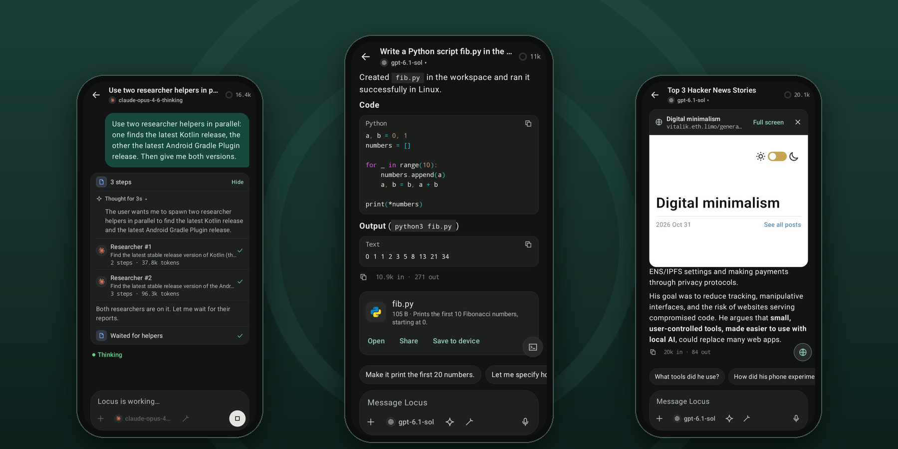

<div align="center">
  
  <h1>Locus</h1>

An AI agent that lives on your Android phone and works with the model you choose.

[](https://github.com/springmusk026/locus/actions/workflows/ci.yml)
[](https://github.com/springmusk026/locus/releases)
[](LICENSE)


[Download](#download) · [What it does](#what-it-does) · [Screenshots](#screenshots) · [Build](#build-from-source) · [Roadmap](docs/ROADMAP.md)

</div>

<p align="center">
  
</p>

Locus gives a capable model hands on your phone: a Linux shell, a browser you can watch, your files, your servers. It plans, works through many steps and asks before anything that matters. There's no Locus account and no Locus server. Your keys stay encrypted on the device, and requests go straight to the provider you picked, or nowhere at all if you run the model on the phone.

## Download

Grab the latest APK from [**Releases**](https://github.com/springmusk026/locus/releases) and open it on a phone running Android 8.0 or newer.

> [!NOTE]
> Locus is in active development, and the way data is stored can still change between versions. Each release also has a `-debug` APK, which is unminified for readable crash reports.

On first launch a short setup walks you through choosing a model, naming your agent and preparing the Linux workspace.

## What it does

**Bring any model.** Use an Anthropic or OpenAI API key, any OpenAI-compatible server (OpenRouter, Groq, Gemini, Ollama, LM Studio, vLLM), your **ChatGPT Plus or Pro plan** through OpenAI's official sign-in, or **Gemma 4 running entirely on the phone**. Switch models per chat.

**Real tools, not a demo:**
- An Alpine Linux shell on the phone, no root needed, with Python, Node and git a command away
- A browser the agent drives while you watch, with logins, payments and form submits always confirmed by you
- SSH to your own servers, including long jobs that survive disconnects
- MCP servers, HTTP connectors, and integrations for search (Firecrawl, Tavily, Brave, Exa), GitHub, Vercel, Netlify, Cloudflare, Supabase, Render, email, and notifications through ntfy or your own Telegram bot
- A workspace you can open from Android's Files app, with viewers for PDF, code, Markdown, tables and media

**Works like an agent.** It plans before acting when you ask, keeps a live checklist, hands research and side jobs to helpers that run in parallel, remembers what you teach it, and writes its own skills and connectors for you to approve. Regenerate any reply, edit a message as a new branch, or fork a chat from any point.

**Stays under your control.** Every tool is set to Allow, Ask or Deny. Approvals come to the chat or to a notification that needs the phone unlocked. An optional reviewer checks actions against what you actually asked for. Activity shows every action the agent took, and deleted files go to a trash you can restore from.

## Screenshots

<table>
  <tr>
    <td></td>
    <td></td>
    <td></td>
    <td></td>
  </tr>
  <tr>
    <td></td>
    <td></td>
    <td></td>
    <td></td>
  </tr>
</table>

## Privacy

- No analytics, telemetry or crash reporting, and no Locus server.
- API keys and sign-in tokens are encrypted with Tink under an Android Keystore key, kept out of backups, and never shown to the model.
- The only network requests are to the providers and services you configure. The optional model catalogue (models.dev) stays off until you turn it on.
- Locus doesn't use an AccessibilityService and can't read or control other apps.

## Build from source

You need JDK 21 (Android Studio's bundled one works) and the Android SDK.

```sh
git clone https://github.com/springmusk026/locus.git && cd locus
./gradlew :app:assembleDebug                 # app/build/outputs/apk/debug/app-debug.apk
./gradlew testDebugUnitTest :core:agent:test :core:llm:test :core:model:test lintDebug
```

The Linux workspace uses prebuilt proot binaries from `core/linux/src/main/jniLibs`; `tools/build-proot.sh` rebuilds them from pinned sources with NDK r29.

Kotlin, Jetpack Compose and MVVM across 20 modules. [docs/ARCHITECTURE.md](docs/ARCHITECTURE.md) covers the design and why each library was chosen; [docs/STATE.md](docs/STATE.md) says what's built, what's tested and what's next; [docs/TESTING.md](docs/TESTING.md) covers running the tests and coverage.

## Contributing

Bug reports and ideas are welcome in [Issues](https://github.com/springmusk026/locus/issues). For code, read [CONTRIBUTING.md](CONTRIBUTING.md) first and open an issue before anything large. Report security problems privately, as [SECURITY.md](SECURITY.md) describes.

## License

[AGPL-3.0-or-later](LICENSE). If you distribute a modified Locus or offer one over a network, you must share its source under the same licence. Bundled third-party code keeps its own licence: see [core/linux/NOTICE](core/linux/NOTICE) and [core/designsystem/NOTICE.md](core/designsystem/NOTICE.md). Product names and logos belong to their owners and only identify the service you connect.
