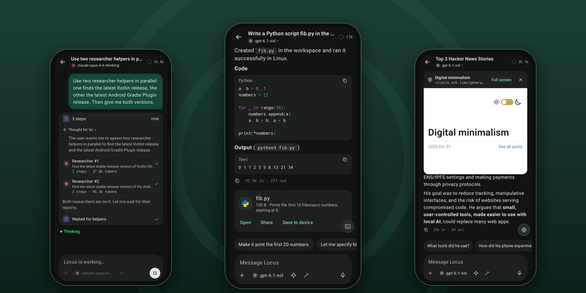
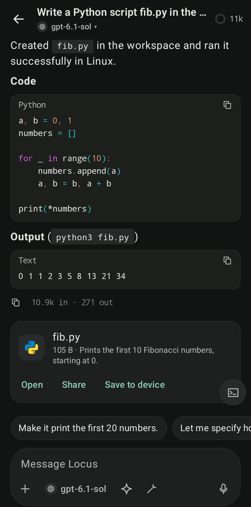
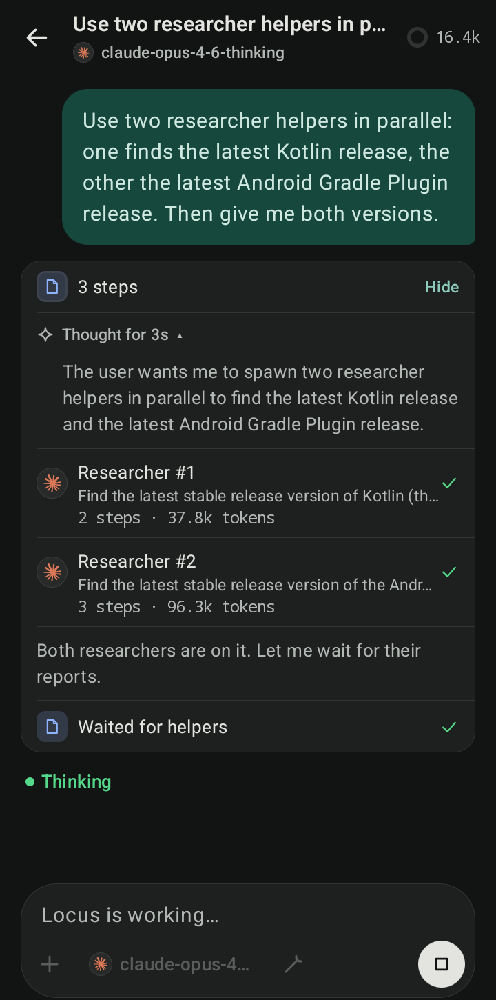
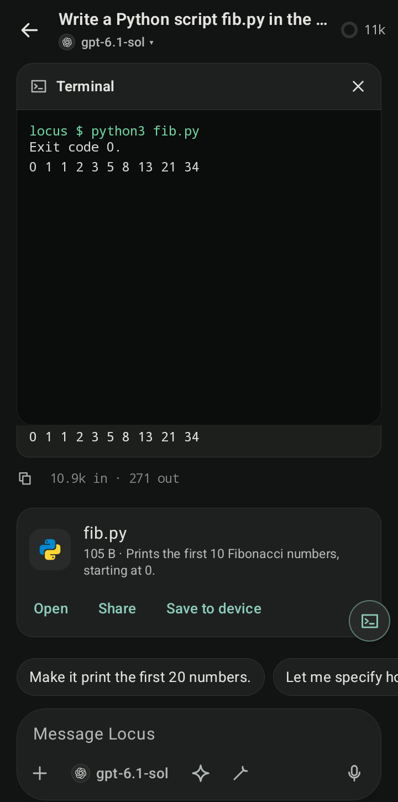
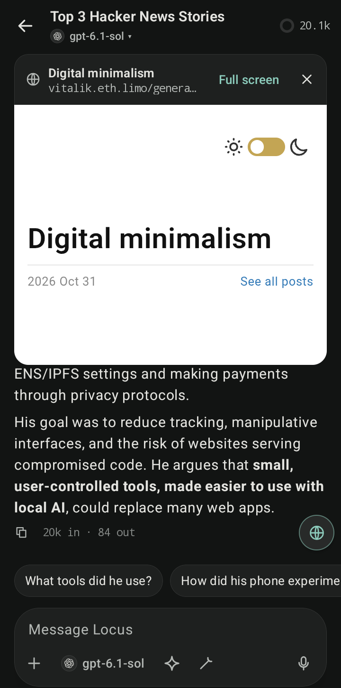
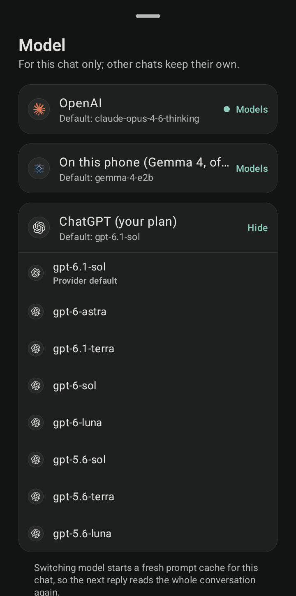
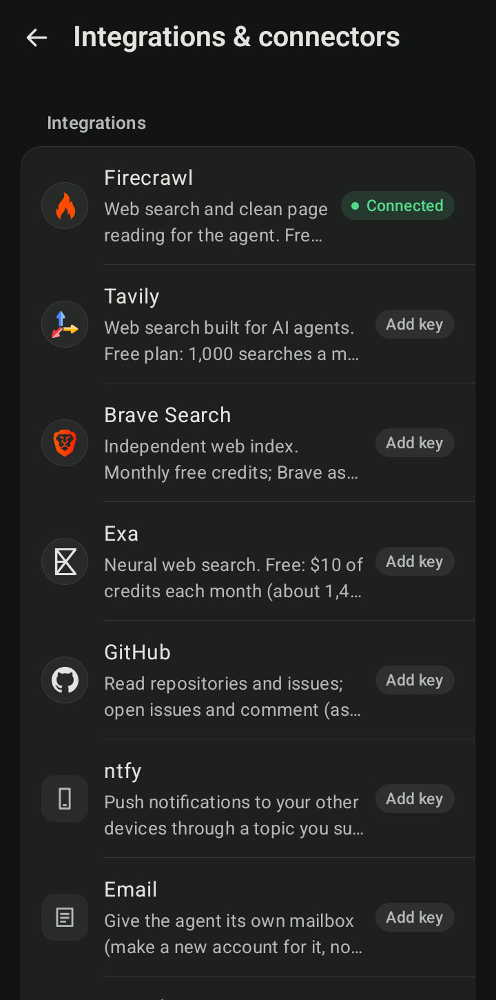
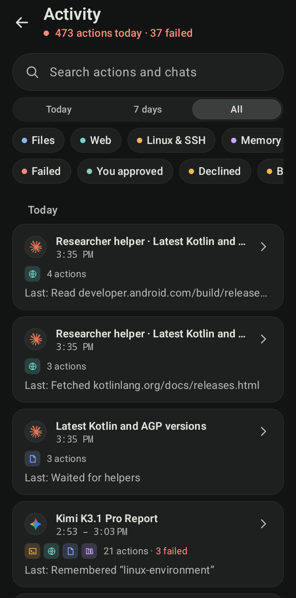
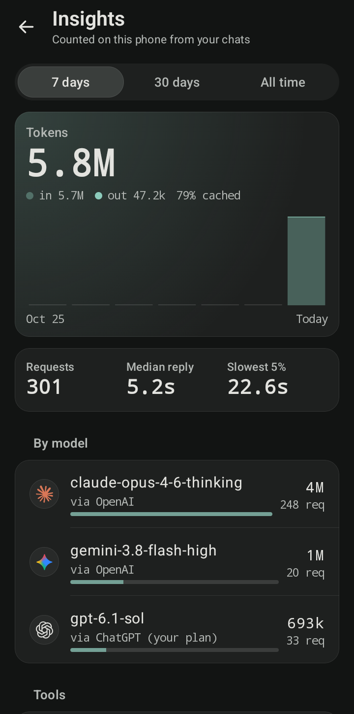
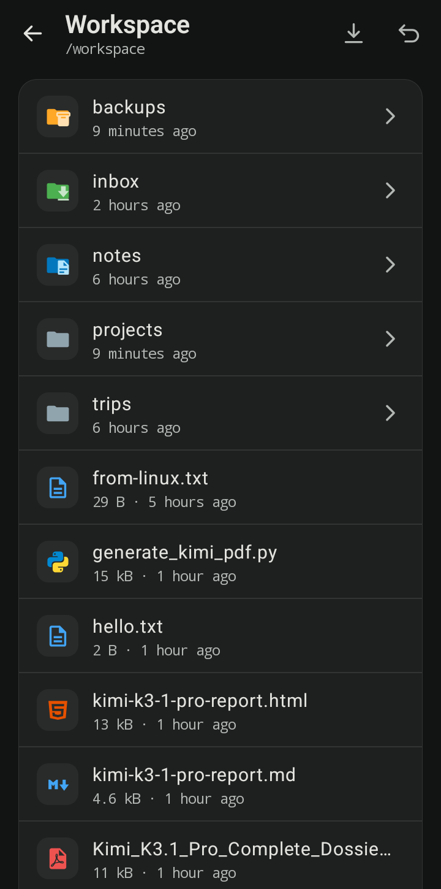

<div align="center">

[English](README.md) · [Español](README.es.md) · **Português (Brasil)** · [简体中文](README.zh-Hans.md)

  
  <h1>Locus</h1>

**Um agente de IA que mora no seu celular Android e trabalha com o modelo que você escolher.**<br>
Use sua própria chave, seu plano do ChatGPT, um servidor local ou um modelo no próprio telefone. Sem conta do Locus, sem servidor do Locus.

[](https://github.com/springmusk026/locus/actions/workflows/ci.yml)
[](https://github.com/springmusk026/locus/releases/latest)
[](LICENSE)
[-3DDC84?logo=android&logoColor=white)](#download-e-atualizações)

[](https://github.com/springmusk026/locus/releases/latest)
[](#download-e-atualizações)
[](https://github.com/sponsors/springmusk026)

[Download](#download-e-atualizações) · [Recursos](#recursos) · [Capturas](#capturas-de-tela) · [Segurança](#modelo-de-segurança-e-privacidade) · [Vídeo de lançamento](docs/media/locus-launch.mp4) · [Roteiro](docs/ROADMAP.md) · [Perguntas frequentes](#perguntas-frequentes)

</div>

> [!NOTE]
> Esta é uma tradução do [README em inglês](README.md). Se os dois forem diferentes, vale a versão em inglês.

<p align="center">
  
</p>

O Locus dá a um modelo capaz mãos no seu telefone: um shell Linux, um navegador que você pode acompanhar, seus arquivos, sua agenda e seus próprios servidores. Ele planeja, trabalha ao longo de muitas etapas e pergunta antes de qualquer coisa importante. Suas chaves ficam criptografadas no aparelho, e as solicitações vão direto para o provedor que você escolheu, ou para lugar nenhum se o modelo roda no telefone.

> [!NOTE]
> O Locus está em desenvolvimento ativo, e o jeito como os dados são armazenados ainda pode mudar entre versões. Este README descreve o `main`. Itens marcados com **(em breve)** já estão no `main` e aparecem em [Unreleased no changelog](CHANGELOG.md#unreleased); ainda não estão na última versão lançada, e a maioria ainda não foi testada em um telefone.

## Conteúdo

- [Por que o Locus](#por-que-o-locus)
- [Recursos](#recursos)
- [Capturas de tela](#capturas-de-tela)
- [Download e atualizações](#download-e-atualizações)
- [Modelo de segurança e privacidade](#modelo-de-segurança-e-privacidade)
- [Provedores e modelos compatíveis](#provedores-e-modelos-compatíveis)
- [Compilar a partir do código-fonte](#compilar-a-partir-do-código-fonte)
- [Roteiro](#roteiro)
- [Perguntas frequentes](#perguntas-frequentes)
- [Como contribuir](#como-contribuir)
- [Patrocinadores](#patrocinadores)
- [Histórico de estrelas](#histórico-de-estrelas)
- [Colaboradores](#colaboradores)
- [Agradecimentos](#agradecimentos)
- [Licença](#licença)

## Por que o Locus

- **Seu modelo, suas chaves, sem intermediários.** Anthropic, OpenAI, um plano do ChatGPT, qualquer servidor compatível com a OpenAI ou um modelo rodando no telefone. Não existe conta nem servidor do Locus, nem analytics ou telemetria.
- **Um agente de verdade, não uma caixa de chat.** Um shell Linux com Python, Node e git, um navegador que ele controla enquanto você acompanha, SSH para as suas máquinas, servidores MCP e conectores, ajudantes que trabalham em paralelo e um recibo para cada tarefa.
- **Você no comando.** Cada ferramenta fica em Permitir, Perguntar ou Negar. Depois que uma execução leu conteúdo externo, tudo o que poderia enviar dados para fora pergunta antes, e os segredos nunca chegam ao modelo.
- **Feito para o celular.** Modo de voz, widgets na tela inicial, um bloco nas configurações rápidas, Direct Share, aprovações pelo Telegram, tarefas em segundo plano que respeitam o calor e a bateria, e agenda, lembretes e repasses para os seus outros apps. Em inglês, espanhol, português (Brasil) ou chinês simplificado.

## Recursos

### Modelos

- Chaves de API da Anthropic e da OpenAI, seu **plano ChatGPT Plus ou Pro** pelo login oficial da OpenAI, qualquer servidor compatível com a OpenAI, **Gemma 4** no telefone pelo LiteRT-LM e modelos GGUF pelo llama.cpp ([GGUF no aparelho](docs/design/llamacpp.md)). Troque de modelo em cada chat.
- Modelos de reserva e chaves de reserva assumem quando um modelo fica sem cota, atinge o limite de solicitações ou está sobrecarregado ([reservas](docs/design/fallbacks.md)). O Locus verifica as ferramentas, a visão e a janela de contexto de um modelo antes de mandar trabalho para ele, e diz por que um foi pulado ([capacidades](docs/design/model-capabilities.md)).
- Controle de custos: os recibos de cada tarefa, os orçamentos e as Estatísticas contam leituras e gravações de cache e resumos feitos no servidor, e chats longos são resumidos antes da faixa de preço mais alta do modelo. O esforço segue o padrão de cada modelo ([custo](docs/design/cost.md)); **(em breve)** nos modelos atuais do Claude e do GPT, mudar o esforço no meio de um chat mantém o cache do prompt ([mudanças no meio do chat](docs/design/midchat-config.md)).
- **Comparar modelos (em breve):** mande uma mensagem também para um segundo modelo e fique com a resposta que preferir; o segundo modelo só pode ler ([comparar modelos](docs/design/compare-models.md)). **Planejar com um modelo e executar com outro (em breve)** no modo plano ([planejar e executar](docs/design/plan-run.md)).

### Agente

- Modo plano, uma lista de tarefas ao vivo e ajudantes (subagentes) para pesquisa e trabalhos paralelos, até três ao mesmo tempo ([subagentes](docs/design/subagents.md)).
- Tarefas longas não ficam sem contexto: o trabalho é resumido entre as etapas quando chega perto da janela do modelo ([compactação](docs/design/compaction.md)). Oriente uma tarefa em andamento, faça uma pergunta paralela com `/btw` ou defina um orçamento de tokens, custo e tempo.
- Toda tarefa concluída ganha um recibo: como terminou, quanto tempo levou, arquivos alterados, verificações aprovadas, aprovações e custo estimado ([recibos](docs/design/task-receipt.md)).
- Gere de novo uma resposta, edite uma mensagem como um novo ramo ou crie uma cópia do chat a partir de qualquer ponto ([ramos](docs/design/branching.md)). **Voltar até aqui (em breve)** também restaura os arquivos do espaço de trabalho que os turnos seguintes alteraram, e **Resumir a partir daqui (em breve)** encurta o resto de um chat com um resumo que você pode editar ([voltar](docs/design/rewind.md)).
- Memória que você pode ver e editar, com busca por relevância em qualquer idioma, e habilidades e conectores que o agente rascunha para você aprovar ([busca na memória](docs/design/memory-search.md), [manifestos de habilidades](docs/design/skill-manifests.md)). **(em breve)** Se quiser, aprove cada mudança na memória e deixe o Organizar sugerir o que juntar e o que remover ([aprovação da memória](docs/design/memory-approval.md)).
- **Chats temporários:** não leem nem salvam memória, não aparecem em listas nem em buscas, e são excluídos quando você sai deles ([chats temporários](docs/design/temporary-chats.md)).
- **Prompts salvos (em breve)** com lacunas para preencher, escolhidos com `/` ([prompts salvos](docs/design/saved-prompts.md)). **Importe seus chats do ChatGPT e do Claude (em breve)** a partir da exportação de dados deles, lida no telefone ([importar](docs/design/import-chats.md)).

### Linux, arquivos e código

- Um shell Alpine Linux no telefone, sem root, instalado só se você quiser, com uma página de saúde, reparo e uma lista de pacotes ([instalação do Linux](docs/design/linux-setup.md), [saúde](docs/design/linux-health.md)).
- Um terminal de verdade com abas e uma fileira de teclas extras ([terminal](docs/design/terminal.md)).
- Um espaço de trabalho que você abre pelo app Arquivos do Android, com visualizadores para PDF, código, Markdown, tabelas e mídia. Um cartão abaixo de cada turno lista os arquivos alterados com as diferenças e desfazer por arquivo; builds e testes aparecem como cartões de sucesso ou falha ([acompanhamento de mudanças](docs/design/change-tracking.md)). O agente pode olhar as imagens do espaço de trabalho com um modelo com visão ([ver imagens](docs/design/view-image.md)).
- **Pastas conectadas:** dê ao agente um cofre do Obsidian ou do Logseq, uma pasta do Syncthing ou qualquer pasta pelo seletor do Android ([pastas conectadas](docs/design/connected-folders.md)).
- Gráficos, diagramas e pequenas ferramentas de uma resposta rodam como prévias ao vivo, em um ambiente isolado sem rede nem armazenamento ([artefatos](docs/design/artifacts.md)). **Publique (em breve)** um artefato ou um chat como página web na sua própria conta da Netlify, da Cloudflare ou da Vercel, sem os segredos ([publicar](docs/design/publish.md)).
- SSH para os seus próprios servidores, trabalhos longos que sobrevivem a desconexões e projetos que executam seus comandos em uma das suas máquinas ([execução remota](docs/design/remote-execution.md)).

### Navegador

- Um navegador que o agente controla enquanto você acompanha; logins, pagamentos e envios de formulário são confirmados por você ([navegador](docs/design/browser.md)).
- **Assumir e devolver:** o agente espera e não vê nada até você devolver a página, se quiser com um recado ([assumir](docs/design/browser.md#take-over-and-hand-back)).
- **Barra de endereço, voltar, avançar e recarregar** no navegador em tela cheia; um site que você digita ali conta como um que você mesmo indicou ([barra de endereço](docs/design/browser.md#the-address-bar)).
- **Menus suspensos confiáveis:** menus personalizados, preenchimento automático e listas longas virtualizadas em MUI, Radix, react-select e sites parecidos ([formulários e menus](docs/design/browser.md#forms-and-dropdowns)).
- **Apontar para algo (em breve):** escolha um botão, um link ou uma imagem na página e anexe à sua mensagem; **Ver a página (em breve)** mostra a página de uma etapa anterior do navegador como ela estava ([seletor de elementos](docs/design/browser.md#element-picker), [a página como estava](docs/design/browser.md#the-page-as-it-was)).
- **Logins salvos:** o Locus preenche um usuário, uma senha e um código de duas etapas salvos no site exato sem que o modelo jamais os veja, e oferece salvar um login depois que você entra por conta própria ([logins salvos](docs/design/browser.md#saved-logins)).

### Conectores e integrações

- Servidores MCP por HTTP (com OAuth) ou rodando localmente no Linux, e conectores HTTP com segredos do cofre ([conectores MCP](docs/design/mcp-connectors.md)).
- Busca (Firecrawl, Tavily, Brave, Exa), GitHub, Vercel, Netlify, Cloudflare, Supabase, Render, e-mail, ntfy e Telegram. **(em breve)** Matrix, Gotify e webhooks como canais para avisos e resultados de tarefas ([canais de aviso](docs/design/reach-me-channels.md)).
- **Seus próprios serviços:** modelos para Miniflux, FreshRSS, Paperless-ngx, Immich, Mastodon e Vikunja (e **Jellyfin (em breve)**), com Testar conexão, além de Home Assistant (dispositivos de risco sempre perguntam), Todoist e Nextcloud ([integrações](docs/design/integrations.md)).
- **Formulário de configuração de e-mail:** endereço e senha de app, com as configurações do servidor já preenchidas para os provedores mais comuns e um teste de conexão ([configuração de e-mail](docs/design/email-setup.md)).
- Chats novos carregam as ferramentas do dia a dia e encontram o resto quando precisam, com a busca de ferramentas da própria Anthropic e da OpenAI onde existe ([descoberta de ferramentas](docs/design/tool-discovery.md)).

### No telefone

- **Modo de voz:** uma conversa com as mãos livres, com as mesmas ferramentas e aprovações, usando os serviços de voz do Android e sem guardar áudio ([modo de voz](docs/design/voice-mode.md)).
- **Formas de entrar:** atalhos do inicializador e do Direct Share, um bloco nas configurações rápidas, "Perguntar ao Locus" sobre texto selecionado, o papel de assistente padrão e intents de automação opcionais para Tasker e Automate ([ponte com o Android](docs/design/android-bridge.md)).
- **Widgets na tela inicial:** um widget de status com o que o Locus está fazendo e o último resultado de uma tarefa agendada (**(em breve)** também a próxima execução, ajustado ao tamanho), e **(em breve)** um widget de uso com o gasto ou os tokens de hoje e os últimos sete dias ([widgets](docs/design/android-bridge.md#the-widget)).
- **Seu idioma:** as telas do Locus estão em inglês, espanhol, português (Brasil) e chinês simplificado. Configurações → Idioma escolhe um só para o Locus (Android 13 ou mais recente; telefones mais antigos seguem o idioma do aparelho). O que o modelo lê continua em inglês, e ele responde no idioma em que você escrever ([localização](docs/design/localization.md)).
- **Agenda, lembretes e repasses:** crie, edite e exclua eventos em uma agenda que você escolhe; lembretes com soneca que sobrevivem a uma reinicialização; novos contatos, Salvar como e área de transferência repassados ao sistema com você no controle ([integrações do telefone](docs/design/phone-integrations.md)).
- **Controle remoto pelo Telegram:** aprove uma solicitação em segundo plano pelo chat do seu bot, ou inicie tarefas mandando mensagem para ele. Desativado por padrão ([Telegram](docs/design/telegram-remote.md)).

### Organizando o trabalho

- **Projetos** reúnem chats com a própria pasta (os arquivos que você anexa em um chat do projeto vão para ela), instruções, memória, permissões e modelo padrão, e uma fileira na tela inicial mostra qual projeto precisa de você ([projetos](docs/design/projects.md)). **(em breve)** As regras de projeto executam uma verificação depois das edições ou antes de o agente terminar, ou bloqueiam um comando ([regras](docs/design/rules.md)), e um snapshot opcional permite desfazer o que um comando de shell alterou ([snapshots de shell](docs/design/shell-snapshots.md)).
- **Fluxos de trabalho:** salve uma tarefa que deu certo e execute de novo com novas entradas, quando quiser ou de forma agendada. **Pesquisa (em breve)** já vem pronta: os ajudantes buscam e leem fontes, conferem as afirmações principais e escrevem um relatório com citações ([fluxos de trabalho](docs/design/workflows.md), [pesquisa](docs/design/deep-research.md)).
- **Tarefas agendadas:** execuções somente leitura em segundo plano que avisam por notificação, ntfy ou Telegram, a cada período ou **(em breve)** em um horário do dia ("todo dia às 07:30"). **Eventos** as iniciam quando algo acontece: um compromisso na agenda, uma mensagem do ntfy, um e-mail novo ou outro app, cada um com seu histórico. **(em breve)** Abra o chat de uma tarefa em andamento e mande uma mensagem para assumir ([execuções agendadas](docs/design/scheduled-runs.md), [eventos](docs/design/event-triggers.md)).
- **Precisa de você (em breve):** uma seção na tela inicial com cada aprovação, pergunta e pausa por orçamento, e o que as tarefas agendadas propuseram para você aprovar ([precisa de você](docs/design/needs-you.md)).
- **Bateria e calor:** trabalhos não urgentes esperam enquanto o telefone está quente ou em economia de bateria ([bateria e calor](docs/design/battery-thermal.md)).
- **Backup criptografado e restauração** em um arquivo que você escolhe, verificado antes de qualquer substituição ([backup](docs/design/backup.md)).
- **Início rápido:** configure um modelo e comece; as etapas opcionais esperam como cartões na tela inicial ([início rápido](docs/design/onboarding-quick-start.md)).

## Capturas de tela

<table>
  <tr>
    <td></td>
    <td></td>
    <td></td>
    <td></td>
  </tr>
  <tr>
    <td></td>
    <td></td>
    <td></td>
    <td></td>
  </tr>
  <tr>
    <td></td>
  </tr>
</table>

As capturas mostram a interface em inglês.

## Download e atualizações

Baixe o APK mais recente em [**Releases**](https://github.com/springmusk026/locus/releases/latest). O Locus precisa de um telefone de 64 bits com Android 8.0 ou mais recente.

| Arquivo | Para |
|---|---|
| `locus-v<version>-arm64-v8a.apk` | Quase todos os telefones |
| `locus-v<version>-x86_64.apk` | Chromebooks x86_64 e emuladores |
| `SHA256SUMS.txt` | Somas de verificação dos dois |

Na primeira vez que abrir, escolha um modelo e toque em **Início rápido**, ou siga a configuração completa para dar um nome ao seu agente e instalar o espaço de trabalho Linux.

**Mantendo atualizado.** Escolha uma opção:

- **No app:** ative **Verificar atualizações no GitHub** (na configuração inicial, ou em Configurações → Sobre e privacidade). Vem desativado. O Locus então consulta o GitHub cerca de uma vez por dia no Wi-Fi, confere um APK novo com o `SHA256SUMS.txt` e com a chave de assinatura do app instalado, e o entrega ao instalador do Android para você confirmar. **Incluir versões beta** também oferece as versões de pré-lançamento ([atualizações](docs/design/updates.md)).
- **Com o [Obtainium](https://github.com/ImranR98/Obtainium):** adicione `https://github.com/springmusk026/locus` como fonte do app e, se ele pedir, filtre os APKs com `arm64-v8a` (ou `x86_64`). Se o Locus foi instalado pelo Obtainium, o Locus deixa as atualizações com ele.

**Conferindo um download.** A impressão digital SHA-256 do certificado da chave de lançamento é

```
0fc4ab07aa5522dfabac92d818fd5cf075ead96da4e2b40a757ac80541490e1b
```

Compare com `apksigner verify --print-certs <apk>`. Desde a 0.1.6, os APKs lançados também trazem um atestado de procedência do build:

```sh
gh attestation verify locus-v<version>-arm64-v8a.apk --repo springmusk026/locus \
  --signer-workflow springmusk026/locus/.github/workflows/release.yml
```

Veja [docs/RELEASING.md](docs/RELEASING.md) e [docs/FDROID.md](docs/FDROID.md) sobre builds reproduzíveis. O F-Droid ainda não está disponível ([perguntas frequentes](#perguntas-frequentes)).

## Modelo de segurança e privacidade

O modelo completo, incluindo o que está e o que não está isolado, está em [SECURITY.md](SECURITY.md).

- **Aprovações.** Cada ferramenta fica em Permitir, Perguntar ou Negar, e um chat pode ser limitado ainda mais (Somente leitura, Espaço de trabalho ou Completo). As aprovações chegam no chat ou em uma notificação que exige o telefone desbloqueado; um revisor opcional confere as ações de nível Perguntar com o que você pediu. **(em breve)** Toque e segure em Negar para dizer ao agente por quê ([aprovações lembradas](docs/design/remembered-approvals.md)).
- **Rastreamento de contaminação (taint).** Depois que uma execução leu conteúdo externo (uma página web, um e-mail, a saída de um comando), enviar qualquer coisa para fora, abrir um site que você não indicou e salvar na memória perguntam antes. Depois que ela leu seus próprios dados, um site novo com qualquer coisa no endereço também pergunta ([taint](docs/design/taint.md)).
- **Proteção contra injeção de prompt.** Caracteres ocultos (tags Unicode, controles bidi, sequências de largura zero) são removidos de tudo o que o modelo lê; as ferramentas MCP ficam fixadas e mudanças precisam da sua revisão; links nas respostas que poderiam vazar dados perguntam antes de abrir.
- **Bloquear o Locus e chats bloqueados (em breve).** Um bloqueio opcional pede sua digital, seu rosto ou o bloqueio de tela antes de o Locus mostrar qualquer coisa; um chat bloqueado pergunta antes de abrir e nunca aparece pelo nome em listas, buscas, notificações ou atalhos ([bloqueio do app](docs/design/app-lock.md)).
- **Segredos continuam segredos.** Chaves de API, tokens e logins salvos são criptografados com o Tink sob uma chave do Android Keystore, ficam fora dos backups a menos que você os inclua, e nunca são mostrados ao modelo. Telas que mostram uma chave ou senha bloqueiam capturas de tela.
- **Sem telemetria.** Sem analytics, sem relatórios de falhas e sem servidor do Locus. Diagnóstico é um registro local, limpo de segredos, que só sai se você tocar em Compartilhar ([diagnóstico](docs/design/diagnostics.md)). As únicas solicitações de rede vão para os provedores e serviços que você configura; o catálogo de modelos (models.dev) e a verificação de atualizações ficam desativados até você ativá-los.
- **Sem AccessibilityService.** O Locus não consegue ler nem controlar outros apps. Ele repassa coisas para eles, e você confirma lá.
- **Linux não é um ambiente isolado.** Os comandos Linux rodam como o próprio usuário do app. O Locus esconde seus processos e protege suas configurações contra mudanças vindas do Linux, mas trate os programas Linux como código que você escolheu rodar com as permissões do Locus ([isolamento do Linux](docs/design/linux-isolation.md)).
- **Desfazer.** A Atividade registra cada ação e permite buscar nela, e os arquivos excluídos vão para uma lixeira de onde você pode restaurá-los.

Encontrou uma vulnerabilidade? [Informe em particular](https://github.com/springmusk026/locus/security/advisories/new), como o [SECURITY.md](SECURITY.md) explica.

## Provedores e modelos compatíveis

| Tipo | O que funciona |
|---|---|
| Anthropic | Messages API com cache de prompt, compactação no servidor e esforço |
| OpenAI | Responses API com uma chave de API, ou um plano **ChatGPT Plus ou Pro** pelo login da OpenAI |
| Compatível com a OpenAI | OpenRouter, Groq, Gemini, Ollama, LM Studio, vLLM e qualquer servidor que fale Chat Completions |
| No telefone | Gemma 4 E2B e E4B pelo LiteRT-LM; modelos GGUF pelo llama.cpp, de uma lista recomendada, da busca do Hugging Face, de uma URL ou de um arquivo |

As listas de modelos vêm de cada provedor. As configurações de rede por provedor incluem cabeçalhos extras, um proxy e certificados de CA personalizados ([rede](docs/design/network.md)). Os resultados de benchmark com um modelo real estão em [docs/benchmarks](docs/benchmarks/README.md#results).

## Compilar a partir do código-fonte

Você precisa do JDK 21 (o que vem com o Android Studio serve) e do Android SDK.

```sh
git clone https://github.com/springmusk026/locus.git && cd locus
./gradlew :app:assembleDebug   # app/build/outputs/apk/debug/app-arm64-v8a-debug.apk (x86_64 too)
./gradlew unitTests lintDebug   # every module's JVM unit tests, and lint
```

Um build de depuração é um app separado, `dev.locus.debug` ("Locus Debug"), então ele é instalado ao lado do Locus em vez de por cima dele. O espaço de trabalho Linux usa binários do proot pré-compilados em `core/linux/src/main/jniLibs`; o `tools/build-proot.sh` os recompila a partir de fontes fixadas com o NDK r29.

O Locus é feito em Kotlin, Jetpack Compose e MVVM, em 26 módulos Gradle.

- [docs/ARCHITECTURE.md](docs/ARCHITECTURE.md): o design e por que cada biblioteca foi escolhida
- [docs/STATE.md](docs/STATE.md): o que está pronto, o que está testado e o que vem depois
- [docs/TESTING.md](docs/TESTING.md): os testes unitários, de captura de tela, de instrumentação e de benchmark; a CI também roda o detekt e um mínimo de cobertura com o Kover ([CONTRIBUTING.md](CONTRIBUTING.md#static-analysis-and-coverage))
- [docs/design/](docs/design/): uma nota por recurso, com a pesquisa por trás dele
- [Traduções](CONTRIBUTING.md#translations): onde ficam os textos e como verificá-los

A documentação do projeto está em inglês.

## Roteiro

Prioridades de curto prazo, segundo o [docs/ROADMAP.md](docs/ROADMAP.md):

- **Os bugs da revisão de código de novembro**, e depois **testes no telefone** de tudo o que está marcado como "ainda não testado no telefone" no [STATE.md](docs/STATE.md#tested-on-the-phone-vs-not-yet), incluindo as telas traduzidas.
- **Distribuição:** um novo envio ao F-Droid assim que o Locus cumprir o requisito de idade do projeto; o Google Play foi pesquisado, mas não iniciado.
- **Mais modelos locais:** chats GGUF mais rápidos (um cache KV salvo, processamento na GPU), entrada de imagens para modelos GGUF e Gemini Nano onde houver suporte.
- **Provedores:** um adaptador nativo para o Gemini, e rotas para Bedrock, Vertex e Azure OpenAI.
- **Benchmarks mais difíceis**, para que o conjunto consiga classificar os modelos atuais.
- **Um isolamento do Linux mais forte**, pesquisado em [isolamento do Linux](docs/design/linux-isolation.md).

## Perguntas frequentes

<details>
<summary><strong>Quanto custa?</strong></summary>

O Locus é gratuito. Você paga diretamente ao seu provedor de modelos pelo que usar, pelos preços dele, ou nada se usar um plano do ChatGPT que já tem, seu próprio servidor ou um modelo no aparelho. Os recibos, os orçamentos de tarefa e as Estatísticas mostram o gasto estimado por tarefa e por modelo.
</details>

<details>
<summary><strong>O que sai do meu telefone?</strong></summary>

Só as solicitações aos provedores e serviços que você configurar. Não existe servidor do Locus nem telemetria. A verificação de atualizações e o catálogo do models.dev ficam desativados até você ativá-los. Veja o [modelo de segurança e privacidade](#modelo-de-segurança-e-privacidade).
</details>

<details>
<summary><strong>Preciso de root?</strong></summary>

Não. O espaço de trabalho Linux roda o Alpine Linux com proot como um app comum, e o Locus não usa nenhum AccessibilityService.
</details>

<details>
<summary><strong>O Locus está no F-Droid ou no Google Play?</strong></summary>

Ainda não. As versões lançadas podem ser reproduzidas byte a byte e batem com os seus APKs, e o Locus foi enviado ao F-Droid, mas o envio foi fechado porque o projeto é novo demais. Ele será enviado de novo quando o Locus cumprir esse requisito ([docs/FDROID.md](docs/FDROID.md)). O Google Play foi pesquisado, mas não iniciado. Enquanto isso, use [as versões do GitHub ou o Obtainium](#download-e-atualizações).
</details>

<details>
<summary><strong>Como funciona o espaço de trabalho Linux?</strong></summary>

É um sistema de arquivos raiz do Alpine Linux executado com o proot, baixado só quando você decide instalar. Você tem `apk`, Python, Node e git, um terminal e uma página de saúde com reparos. Ele compartilha o usuário do app Locus, então não é uma barreira de segurança ([instalação do Linux](docs/design/linux-setup.md), [isolamento](docs/design/linux-isolation.md)).
</details>

<details>
<summary><strong>Em quais idiomas ele está?</strong></summary>

O app está em inglês, espanhol, português (Brasil) e chinês simplificado; escolha um em Configurações → Idioma no Android 13 ou mais recente. As traduções foram feitas com ajuda de IA e revisadas quanto ao sentido e à consistência, mas ainda não por falantes nativos, então correções são bem-vindas ([CONTRIBUTING.md](CONTRIBUTING.md#translations)). O modelo responde no idioma em que você escrever.
</details>

<details>
<summary><strong>Funciona sem internet?</strong></summary>

Sim, com um modelo no aparelho: o Gemma 4 pelo LiteRT-LM ou um modelo GGUF pelo llama.cpp. Modelos pequenos são mais lentos e menos capazes com ferramentas do que os grandes hospedados, e precisam de um telefone com memória suficiente; o Locus avisa antes de um modelo grande demais.
</details>

## Como contribuir

Relatos de bugs e ideias são bem-vindos em [Issues](https://github.com/springmusk026/locus/issues/new/choose). Para código, leia o [CONTRIBUTING.md](CONTRIBUTING.md) e abra uma issue antes de qualquer coisa grande. Dúvidas vão para o [SUPPORT.md](SUPPORT.md), e espera-se que todos sigam o [Código de Conduta](CODE_OF_CONDUCT.md).

## Patrocinadores

O Locus é desenvolvido abertamente por um único mantenedor. O patrocínio paga aparelhos para testar, uso de API de modelos para os benchmarks e tempo para mantê-lo livre de anúncios e rastreamento.

- **[GitHub Sponsors](https://github.com/sponsors/springmusk026)**: uma vez ou todo mês.
<!-- TODO(owner): add crypto wallet addresses here (one line per coin, with the network), and the same links under `custom:` in .github/FUNDING.yml if wanted. Until then, no addresses are published anywhere. Restore this line with them:
- **Cripto:** ...
-->

### Patrocinadores em destaque

Organizações que patrocinam o Locus podem ter o logotipo aqui. Entre em contato pelo [GitHub Sponsors](https://github.com/sponsors/springmusk026).

<!-- TODO(owner): add sponsor logos here, each linked to the sponsor's site, for example:
<p align="center">
  <a href="https://example.org"></a>
</p>
-->

### Provedor em destaque

Provedores de IA podem patrocinar o Locus como provedor em destaque. O Locus continua neutro e no modelo "traga sua própria chave":

- Um provedor em destaque só apareceria como uma opção claramente identificada e opcional no seletor de provedores ou na configuração inicial, ao lado de todos os outros provedores.
- Nenhum rastreamento, aviso de indicação ou analytics é adicionado, e as garantias de privacidade do Locus não mudam.
- O Locus nunca troca o provedor ou o modelo padrão de ninguém, e todos os provedores continuam funcionando do mesmo jeito.

Hoje não existe nenhuma opção desse tipo no app. Provedores interessados podem entrar em contato pelo [GitHub Sponsors](https://github.com/sponsors/springmusk026).

## Histórico de estrelas

<a href="https://www.star-history.com/#springmusk026/locus&Date">
  <picture>
    <source media="(prefers-color-scheme: dark)" srcset="https://api.star-history.com/svg?repos=springmusk026/locus&type=Date&theme=dark" />
    <source media="(prefers-color-scheme: light)" srcset="https://api.star-history.com/svg?repos=springmusk026/locus&type=Date" />
    
  </picture>
</a>

## Colaboradores

<a href="https://github.com/springmusk026/locus/graphs/contributors">
  
</a>

## Agradecimentos

O Locus se apoia em muito trabalho de código aberto. Obrigado às pessoas por trás de:

| Projeto | Usado para | Licença |
|---|---|---|
| [Kotlin](https://kotlinlang.org), [kotlinx.coroutines](https://github.com/Kotlin/kotlinx.coroutines), [kotlinx.serialization](https://github.com/Kotlin/kotlinx.serialization) | A linguagem e suas bibliotecas principais | Apache-2.0 |
| [Android Jetpack](https://developer.android.com/jetpack) (Compose, Material 3, Room, WorkManager, DataStore, Navigation 3, Glance, WebKit, JavaScriptEngine) e [Hilt](https://dagger.dev/hilt/) | Interface, armazenamento, trabalho em segundo plano, o navegador e o ambiente isolado de scripts | Apache-2.0 |
| [Ktor](https://ktor.io) | Cliente HTTP para todos os provedores | Apache-2.0 |
| [Tink](https://github.com/tink-crypto/tink-java) | O cofre criptografado e os backups | Apache-2.0 |
| [LiteRT-LM](https://github.com/google-ai-edge/LiteRT-LM) | Gemma no telefone | Apache-2.0 |
| [llama.cpp](https://github.com/ggml-org/llama.cpp) | Modelos GGUF no telefone | MIT |
| [MCP Kotlin SDK](https://github.com/modelcontextprotocol/kotlin-sdk) | Conectores MCP | Apache-2.0 (antes MIT) |
| [ConnectBot sshlib](https://github.com/connectbot/sshlib) | SSH e SFTP | Apache-2.0 |
| [Eclipse Angus Mail](https://github.com/eclipse-ee4j/angus-mail) | E-mail por IMAP e SMTP | EPL-2.0 ou GPL-2.0 com Classpath Exception |
| [jsoup](https://jsoup.org) | Leitura de páginas web | MIT |
| [Multiplatform Markdown Renderer](https://github.com/mikepenz/multiplatform-markdown-renderer), [LaTeX renderer](https://github.com/huarangmeng/latex), [Mermaid](https://mermaid.js.org) | Exibição de respostas, fórmulas e diagramas | Apache-2.0, MIT, MIT |
| [Termux terminal-emulator e terminal-view](https://github.com/termux/termux-app) | O terminal | Apache-2.0 |
| [PRoot](https://github.com/termux/proot), [talloc](https://talloc.samba.org), [Alpine Linux](https://alpinelinux.org) | O espaço de trabalho Linux | GPL-2.0-or-later, LGPL-3.0-or-later, conforme o pacote |
| [LobeHub Icons](https://github.com/lobehub/lobe-icons), [Simple Icons](https://github.com/simple-icons/simple-icons), [Material Icon Theme](https://github.com/material-extensions/vscode-material-icon-theme) | Ícones de provedores, serviços e tipos de arquivo | MIT, CC0-1.0, MIT |
| [models.dev](https://models.dev) | O catálogo opcional de modelos (um serviço online, desativado por padrão) | n/a |
| [Roborazzi](https://github.com/takahirom/roborazzi), [Robolectric](https://robolectric.org), [Turbine](https://github.com/cashapp/turbine), [GreenMail](https://greenmail-mail-test.github.io/greenmail/), [Kover](https://github.com/Kotlin/kotlinx-kover), [detekt](https://detekt.dev), [Compose Rules](https://github.com/mrmans0n/compose-rules) | Testes, cobertura e análise estática | Apache-2.0, MIT, Apache-2.0, Apache-2.0, Apache-2.0, Apache-2.0, Apache-2.0 |

O código de terceiros incluído mantém a própria licença; os detalhes estão em [core/linux/NOTICE](core/linux/NOTICE), [core/terminal/NOTICE](core/terminal/NOTICE), [core/designsystem/NOTICE.md](core/designsystem/NOTICE.md) e [core/markdown/NOTICE.md](core/markdown/NOTICE.md). Nomes e logotipos de produtos pertencem aos seus donos e só identificam o serviço que você conecta.

## Licença

O Locus é licenciado sob a [GNU Affero General Public License v3.0 ou posterior](LICENSE). Se você distribuir um Locus modificado ou oferecê-lo por uma rede, precisa compartilhar o código-fonte sob a mesma licença.
