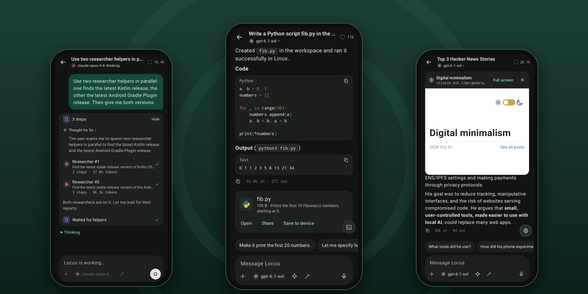
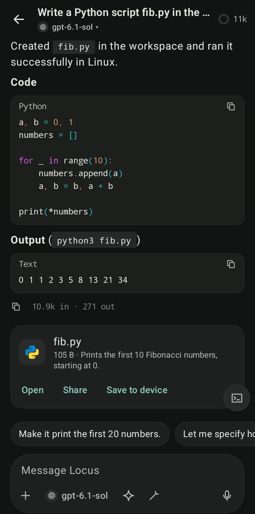
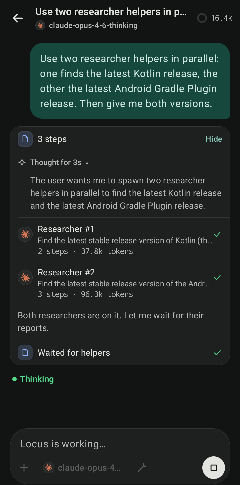
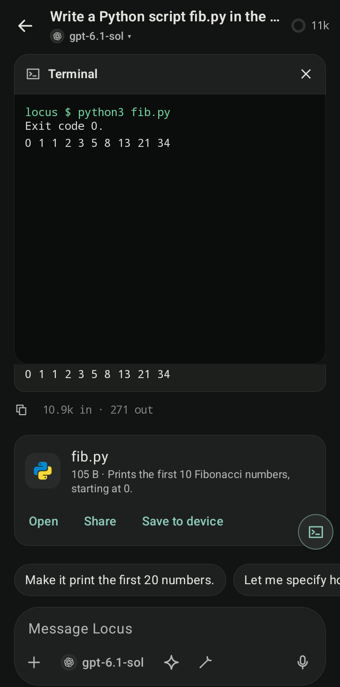
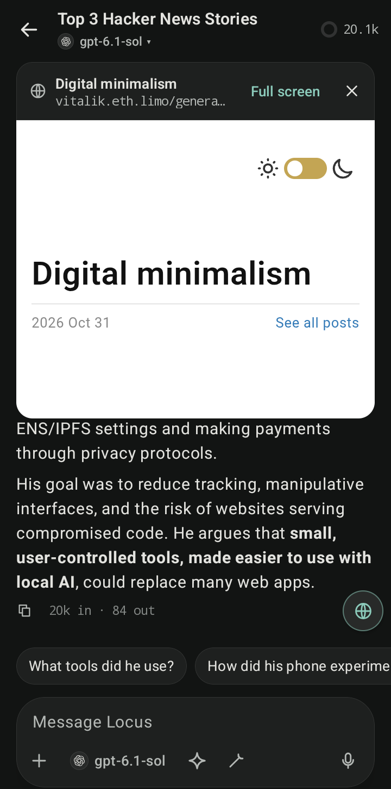
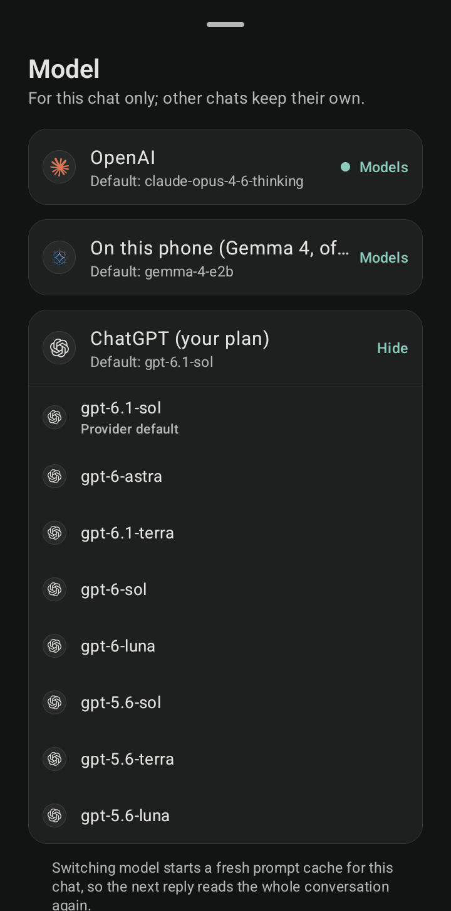
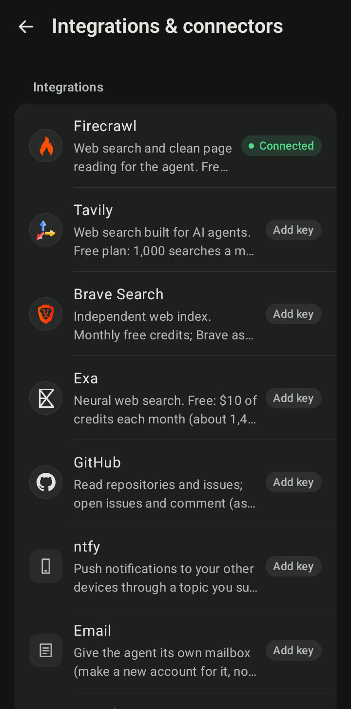
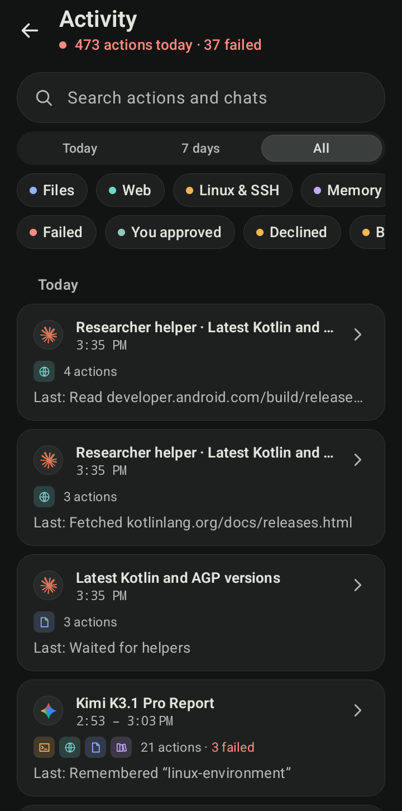
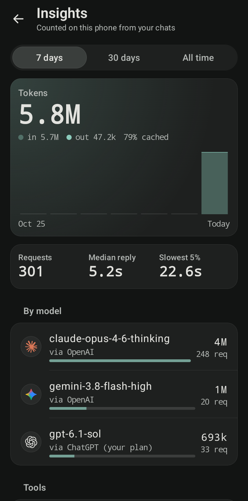
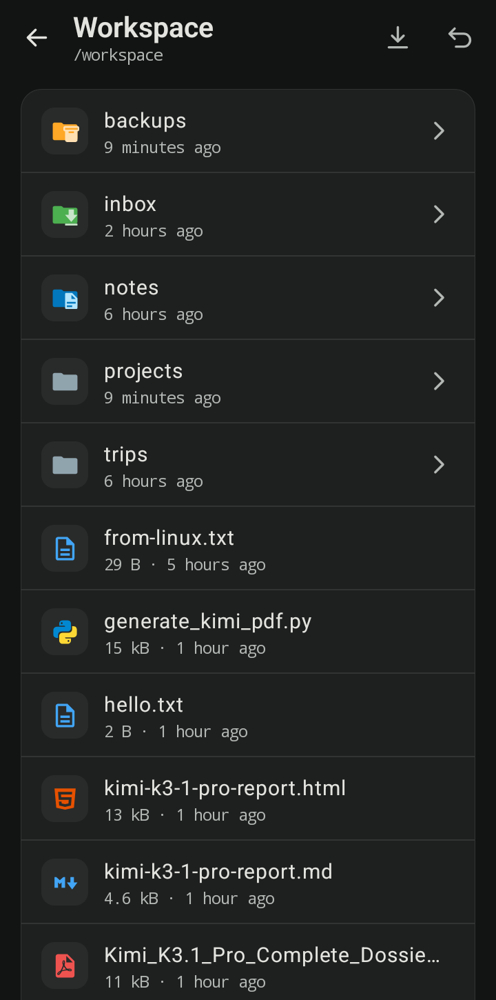

<div align="center">

[English](README.md) · [Español](README.es.md) · [Português (Brasil)](README.pt-BR.md) · **简体中文**

  
  <h1>Locus</h1>

**一个住在你的 Android 手机上、使用你所选模型工作的 AI 智能体。**<br>
自带密钥、ChatGPT 订阅、本地服务器或手机上的模型。没有 Locus 账号，也没有 Locus 服务器。

[](https://github.com/springmusk026/locus/actions/workflows/ci.yml)
[](https://github.com/springmusk026/locus/releases/latest)
[](LICENSE)
[-3DDC84?logo=android&logoColor=white)](#下载与更新)

[](https://github.com/springmusk026/locus/releases/latest)
[](#下载与更新)
[](https://github.com/sponsors/springmusk026)

[下载](#下载与更新) · [功能](#功能) · [截图](#截图) · [安全](#安全与隐私模型) · [发布视频](docs/media/locus-launch.mp4) · [路线图](docs/ROADMAP.md) · [常见问题](#常见问题)

</div>

> [!NOTE]
> 这是[英文 README](README.md) 的翻译。两者内容不一致时，以英文版为准。

<p align="center">
  
</p>

Locus 让一个能力强的模型在你的手机上动手做事：Linux shell、一个你可以旁观的浏览器、你的文件、你的日历和你自己的服务器。它会做计划，分多步完成工作，遇到重要的事先问你。你的密钥加密保存在设备上，请求直接发往你选择的提供商；如果模型在手机上运行，请求哪里也不去。

> [!NOTE]
> Locus 正在积极开发中，数据的存储方式在不同版本之间仍可能变化。本 README 描述的是 `main` 分支。标有 **（即将推出）** 的内容已在 `main` 上，并列在[更新日志的 Unreleased 部分](CHANGELOG.md#unreleased)；它们还不在最新发布的版本中，其中大部分也还没有在手机上试过。

## 目录

- [为什么选择 Locus](#为什么选择-locus)
- [功能](#功能)
- [截图](#截图)
- [下载与更新](#下载与更新)
- [安全与隐私模型](#安全与隐私模型)
- [支持的提供商和模型](#支持的提供商和模型)
- [从源码构建](#从源码构建)
- [路线图](#路线图)
- [常见问题](#常见问题)
- [参与贡献](#参与贡献)
- [赞助](#赞助)
- [Star 历史](#star-历史)
- [贡献者](#贡献者)
- [致谢](#致谢)
- [许可证](#许可证)

## 为什么选择 Locus

- **你的模型，你的密钥，没有中间人。** Anthropic、OpenAI、ChatGPT 订阅、任何兼容 OpenAI 的服务器，或在手机上运行的模型。没有 Locus 账号或服务器，也没有分析或遥测。
- **真正的智能体，而不只是聊天框。** 带 Python、Node 和 git 的 Linux shell，一个在你注视下由它操作的浏览器，通往你的机器的 SSH，MCP 服务器和连接器，并行工作的助手，以及每个任务的回执。
- **一切由你掌控。** 每个工具都设为允许、询问或拒绝。一次运行读过外部内容之后，任何可能把数据发出去的操作都会先询问，而且机密信息永远不会交给模型。
- **为手机而生。** 语音模式、主屏幕小部件、快捷设置图块、Direct Share、Telegram 批准、顾及发热和电量的后台任务，以及日历、提醒和交给其他应用的操作。支持英语、西班牙语、葡萄牙语（巴西）和简体中文。

## 功能

### 模型

- Anthropic 和 OpenAI 的 API 密钥，通过 OpenAI 官方登录使用你的 **ChatGPT Plus 或 Pro 订阅**，任何兼容 OpenAI 的服务器，通过 LiteRT-LM 在手机上运行的 **Gemma 4**，以及通过 llama.cpp 运行的 GGUF 模型（[设备上的 GGUF](docs/design/llamacpp.md)）。每个对话都可以换模型。
- 当某个模型额度用完、被限流或过载时，备用模型和备用密钥会接替（[备用](docs/design/fallbacks.md)）。Locus 在把工作交给某个模型之前，会检查它的工具调用、视觉能力和上下文窗口，并说明为什么跳过了某个模型（[能力](docs/design/model-capabilities.md)）。
- 成本统计：任务回执、预算和统计页面会计入缓存读写和服务器端摘要，长对话会在模型的价格档位之前完成摘要。思考强度默认跟随每个模型自己的默认值（[成本](docs/design/cost.md)）；**（即将推出）** 在当前的 Claude 和 GPT 模型上，对话中途更改思考强度也能保留提示词缓存（[对话中途的更改](docs/design/midchat-config.md)）。
- **对比模型（即将推出）：** 把一条消息同时发给第二个模型，保留你更喜欢的回答；第二个模型只能读取（[对比模型](docs/design/compare-models.md)）。在计划模式下**用一个模型做计划，用另一个模型执行（即将推出）**（[计划与执行](docs/design/plan-run.md)）。

### 智能体

- 计划模式、实时清单，以及用于研究和支线工作的助手（子智能体），最多同时三个（[子智能体](docs/design/subagents.md)）。
- 长任务不会耗尽上下文：接近模型窗口上限时，工作会在步骤之间被摘要（[压缩](docs/design/compaction.md)）。你可以引导正在运行的任务，用 `/btw` 插问一个旁支问题，或为令牌、费用和时间设定预算。
- 每个完成的任务都有一份回执：如何结束、用时、更改的文件、通过的检查、批准情况和估算费用（[回执](docs/design/task-receipt.md)）。
- 重新生成回复、把编辑后的消息作为新分支，或从任意位置分叉对话（[分支](docs/design/branching.md)）。**回退到这里（即将推出）** 还会把之后各轮改动过的工作区文件恢复原样，**从这里开始总结（即将推出）** 用一份你可以编辑的摘要缩短对话的其余部分（[回退](docs/design/rewind.md)）。
- 你能查看和编辑的记忆，支持任何语言的排序搜索；智能体起草的技能和连接器需要你批准（[记忆搜索](docs/design/memory-search.md)、[技能清单](docs/design/skill-manifests.md)）。**（即将推出）** 可选择批准每一次记忆更改，并让“整理”建议合并和删除哪些内容（[记忆批准](docs/design/memory-approval.md)）。
- **临时对话：** 不读取也不保存记忆，不出现在列表和搜索中，离开后即被删除（[临时对话](docs/design/temporary-chats.md)）。
- **保存的提示词（即将推出）**，带可填写的空位，输入 `/` 即可选用（[保存的提示词](docs/design/saved-prompts.md)）。**导入你的 ChatGPT 和 Claude 对话（即将推出）**，从它们的数据导出文件导入，在手机上读取（[导入](docs/design/import-chats.md)）。

### Linux、文件与代码

- 手机上的 Alpine Linux shell，无需 root，只在你选择时安装，带健康页面、修复功能和软件包列表（[Linux 安装](docs/design/linux-setup.md)、[健康](docs/design/linux-health.md)）。
- 一个真正的终端，带标签页和一行额外按键（[终端](docs/design/terminal.md)）。
- 一个可以从 Android“文件”应用打开的工作区，带 PDF、代码、Markdown、表格和媒体查看器。每一轮下方的卡片会列出更改过的文件，附带差异和逐文件撤销；构建和测试以通过或失败卡片显示（[变更跟踪](docs/design/change-tracking.md)）。配合有视觉能力的模型，智能体可以查看工作区里的图片（[查看图片](docs/design/view-image.md)）。
- **已连接的文件夹：** 通过 Android 的文件夹选择器，把 Obsidian 或 Logseq 库、Syncthing 文件夹或任何文件夹交给智能体（[已连接的文件夹](docs/design/connected-folders.md)）。
- 回复中的图表、示意图和小工具会在一个没有网络和存储的沙盒中作为实时预览运行（[制品](docs/design/artifacts.md)）。**发布（即将推出）**：在清除机密信息后，把一个制品或一段对话作为网页发布到你自己的 Netlify、Cloudflare 或 Vercel 账号（[发布](docs/design/publish.md)）。
- 通过 SSH 连接你自己的服务器，长时间作业在断线后继续运行，项目可以在你的某台机器上执行命令（[远程执行](docs/design/remote-execution.md)）。

### 浏览器

- 一个由智能体在你注视下操作的浏览器；登录、付款和提交表单都由你确认（[浏览器](docs/design/browser.md)）。
- **接管与交还：** 在你交还页面之前，智能体会等待，什么也看不到；交还时可以附一句说明（[接管](docs/design/browser.md#take-over-and-hand-back)）。
- **地址栏、后退、前进和刷新**，在全屏浏览器中可用；你在地址栏输入的网站视为你指定的网站（[地址栏](docs/design/browser.md#the-address-bar)）。
- **可靠的下拉菜单：** 支持 MUI、Radix、react-select 等网站上的自定义菜单、自动补全和虚拟化长列表（[表单和下拉菜单](docs/design/browser.md#forms-and-dropdowns)）。
- **指给它看（即将推出）：** 选中页面上的按钮、链接或图片，附加到你的消息里；**查看页面（即将推出）** 显示浏览器某个过往步骤当时的页面（[页面元素选取](docs/design/browser.md#element-picker)、[当时的页面](docs/design/browser.md#the-page-as-it-was)）。
- **保存的登录信息：** Locus 只在完全匹配的网站上填入保存的用户名、密码和两步验证码，模型永远看不到它们；在你自己登录后，Locus 会提议保存这次登录（[保存的登录信息](docs/design/browser.md#saved-logins)）。

### 连接器与集成

- 通过 HTTP（支持 OAuth）或在 Linux 中本地运行的 MCP 服务器，以及使用保险库机密的 HTTP 连接器（[MCP 连接器](docs/design/mcp-connectors.md)）。
- 搜索（Firecrawl、Tavily、Brave、Exa）、GitHub、Vercel、Netlify、Cloudflare、Supabase、Render、电子邮件、ntfy 和 Telegram。**（即将推出）** Matrix、Gotify 和 webhook 可作为通知和任务结果的渠道（[通知渠道](docs/design/reach-me-channels.md)）。
- **你自己的服务：** Miniflux、FreshRSS、Paperless-ngx、Immich、Mastodon 和 Vikunja 的模板（以及 **Jellyfin（即将推出）**），带“测试连接”，另有 Home Assistant（有风险的设备总会询问）、Todoist 和 Nextcloud 预设（[集成](docs/design/integrations.md)）。
- **邮件设置表单：** 填写地址和应用专用密码，常见邮件服务商的服务器设置会自动填好，并可测试连接（[邮件设置](docs/design/email-setup.md)）。
- 新对话会加载日常工具，其余工具在需要时再查找；在可用时使用 Anthropic 和 OpenAI 自己的工具搜索（[工具发现](docs/design/tool-discovery.md)）。

### 在手机上

- **语音模式：** 免提对话，使用同样的工具和批准流程，借助 Android 的语音服务，不保留任何音频（[语音模式](docs/design/voice-mode.md)）。
- **入口：** 启动器和 Direct Share 快捷方式、快捷设置图块、选中文字后的“询问 Locus”、默认助理角色，以及供 Tasker 和 Automate 使用的可选自动化 intent（[Android 桥接](docs/design/android-bridge.md)）。
- **主屏幕小部件：** 一个状态小部件，显示 Locus 正在做什么和最近一次定时任务的结果（**（即将推出）** 还会显示下一次运行，并按尺寸排布内容）；以及 **（即将推出）** 一个用量小部件，显示今天的花费或令牌数和最近七天的情况（[小部件](docs/design/android-bridge.md#the-widget)）。
- **你的语言：** Locus 的界面提供英语、西班牙语、葡萄牙语（巴西）和简体中文。“设置 → 语言”可以单独为 Locus 选择语言（Android 13 及以上；更早的手机跟随系统语言）。模型读取的内容仍是英语，而它会用你写给它的语言回答（[本地化](docs/design/localization.md)）。
- **日历、提醒和转交：** 在你选定的一个日历上创建、编辑和删除日程；可稍后提醒、重启后仍然有效的提醒；新建联系人、“另存为”和剪贴板交给系统处理，全程由你确认（[手机集成](docs/design/phone-integrations.md)）。
- **Telegram 远程：** 在你的机器人对话中批准后台请求，或给它发消息来启动任务。默认关闭（[Telegram 远程](docs/design/telegram-remote.md)）。

### 组织工作

- **项目**把对话归到一起，各有自己的文件夹（在项目对话中添加的附件会放进这个文件夹）、指令、记忆、权限和默认模型，主屏幕上的一栏会显示哪个项目需要你处理（[项目](docs/design/projects.md)）。**（即将推出）** 项目规则可以在编辑之后或智能体结束之前运行检查，或拦截某条命令（[规则](docs/design/rules.md)）；可选的快照让你撤销 shell 命令所做的更改（[shell 快照](docs/design/shell-snapshots.md)）。
- **工作流：** 把一次顺利完成的任务保存下来，用新的输入再次运行，可以随时运行，也可以定时运行。**研究（即将推出）** 已内置：助手搜索并阅读资料来源，核对关键论断，写出带引用的报告（[工作流](docs/design/workflows.md)、[研究](docs/design/deep-research.md)）。
- **定时任务：** 只读的后台运行，通过通知、ntfy 或 Telegram 汇报结果，可以按周期运行，或 **（即将推出）** 在每天的固定时间运行（“每天 07:30”）。**事件触发**会在某件事发生时启动任务：一条日程、一条 ntfy 消息、一封新邮件或另一个应用，每种都有历史记录。**（即将推出）** 打开正在运行的任务的对话并发送消息，即可接管它（[定时运行](docs/design/scheduled-runs.md)、[事件触发](docs/design/event-triggers.md)）。
- **待你处理（即将推出）：** 主屏幕上的一个区域，汇集所有批准、问题和预算暂停，以及定时任务提出、等你批准的操作（[待你处理](docs/design/needs-you.md)）。
- **电池与发热：** 手机发热或处于省电模式时，不紧急的工作会等待（[电池与发热](docs/design/battery-thermal.md)）。
- **加密备份与恢复**，保存到你选择的文件，在替换任何内容之前先校验（[备份](docs/design/backup.md)）。
- **快速开始：** 设置一个模型就能开始；可选步骤会以卡片形式留在主屏幕上（[快速开始](docs/design/onboarding-quick-start.md)）。

## 截图

<table>
  <tr>
    <td></td>
    <td></td>
    <td></td>
    <td></td>
  </tr>
  <tr>
    <td></td>
    <td></td>
    <td></td>
    <td></td>
  </tr>
  <tr>
    <td></td>
  </tr>
</table>

截图显示的是英文界面。

## 下载与更新

从 [**Releases**](https://github.com/springmusk026/locus/releases/latest) 下载最新的 APK。Locus 需要运行 Android 8.0 或更高版本的 64 位手机。

| 文件 | 适用于 |
|---|---|
| `locus-v<version>-arm64-v8a.apk` | 几乎所有手机 |
| `locus-v<version>-x86_64.apk` | x86_64 Chromebook 和模拟器 |
| `SHA256SUMS.txt` | 两者的校验和 |

首次启动时，选择一个模型并点按**快速开始**，或者走完整设置流程，为你的智能体命名并安装 Linux 工作区。

**保持更新。** 任选一种方式：

- **在应用内：** 打开**在 GitHub 检查更新**（在初始设置中，或在“设置 → 关于与隐私”中）。默认关闭。开启后，Locus 大约每天在 Wi-Fi 下询问一次 GitHub，用 `SHA256SUMS.txt` 和已安装应用的签名密钥校验新的 APK，再交给 Android 安装程序由你确认。**包含测试版**还会提供预发布版本（[更新](docs/design/updates.md)）。
- **使用 [Obtainium](https://github.com/ImranR98/Obtainium)：** 把 `https://github.com/springmusk026/locus` 添加为应用来源，如果它询问，就用 `arm64-v8a`（或 `x86_64`）筛选 APK。如果 Locus 是通过 Obtainium 安装的，Locus 会把更新交给它处理。

**校验下载。** 发布密钥的 SHA-256 证书指纹是

```
0fc4ab07aa5522dfabac92d818fd5cf075ead96da4e2b40a757ac80541490e1b
```

用 `apksigner verify --print-certs <apk>` 进行比对。从 0.1.6 起，发布的 APK 还带有构建来源证明：

```sh
gh attestation verify locus-v<version>-arm64-v8a.apk --repo springmusk026/locus \
  --signer-workflow springmusk026/locus/.github/workflows/release.yml
```

关于可复现构建，请参阅 [docs/RELEASING.md](docs/RELEASING.md) 和 [docs/FDROID.md](docs/FDROID.md)。目前还不能从 F-Droid 获取（[常见问题](#常见问题)）。

## 安全与隐私模型

完整的模型，包括哪些内容被隔离、哪些没有，见 [SECURITY.md](SECURITY.md)。

- **批准。** 每个工具都设为允许、询问或拒绝，单个对话还可以进一步限制（只读、工作区或完全）。批准请求会出现在对话中，或出现在需要解锁手机才能操作的通知中；可选的审查器会把“询问”级别的操作与你的要求进行比对。**（即将推出）** 长按“拒绝”可以告诉智能体原因（[记住的批准](docs/design/remembered-approvals.md)）。
- **污点跟踪。** 一次运行读过外部内容（网页、邮件、命令输出）之后，向外发送任何内容、打开你没有指定的网站以及保存到记忆，都会先询问。读过你自己的数据之后，访问地址中带有任何内容的新网站也会询问（[污点](docs/design/taint.md)）。
- **提示词注入防护。** 隐藏字符（Unicode 标签、双向控制符、零宽字符序列）会从模型读取的所有内容中去除；MCP 工具会被固定，变更需要你审核；回复中可能泄露数据的链接会在打开前询问。
- **锁定 Locus 和锁定的对话（即将推出）。** 可选的锁会在 Locus 显示任何内容之前要求指纹、人脸或屏幕锁；锁定的对话在打开前会询问，并且永远不会在列表、搜索、通知或快捷方式中显示名称（[应用锁](docs/design/app-lock.md)）。
- **机密信息保持机密。** API 密钥、令牌和保存的登录信息使用 Tink 在 Android Keystore 密钥下加密，除非你选择包含，否则不会进入备份，也永远不会展示给模型。显示密钥或密码的界面会禁止截屏。
- **没有遥测。** 没有分析、崩溃上报或 Locus 服务器。诊断是一份本地日志，已清除机密信息，只有你点按“分享”时才会离开手机（[诊断](docs/design/diagnostics.md)）。网络请求只发往你配置的提供商和服务；模型目录（models.dev）和更新检查在你开启之前都是关闭的。
- **不使用 AccessibilityService。** Locus 无法读取或控制其他应用。它把内容交给它们，由你在那里确认。
- **Linux 不是沙盒。** Linux 命令以应用自己的用户身份运行。Locus 会隐藏自己的进程，并保护自己的设置不被 Linux 修改，但请把 Linux 程序视为你选择以 Locus 的权限运行的代码（[Linux 隔离](docs/design/linux-isolation.md)）。
- **撤销。** “活动”记录每一个操作并可搜索，删除的文件会进入回收站，可以从中恢复。

发现了漏洞？请按照 [SECURITY.md](SECURITY.md) 的说明[私下报告](https://github.com/springmusk026/locus/security/advisories/new)。

## 支持的提供商和模型

| 类型 | 支持内容 |
|---|---|
| Anthropic | Messages API，支持提示词缓存、服务器端压缩和思考强度 |
| OpenAI | 使用 API 密钥的 Responses API，或通过 OpenAI 登录使用 **ChatGPT Plus 或 Pro** 订阅 |
| 兼容 OpenAI | OpenRouter、Groq、Gemini、Ollama、LM Studio、vLLM，以及任何支持 Chat Completions 的服务器 |
| 在手机上 | 通过 LiteRT-LM 运行的 Gemma 4 E2B 和 E4B；通过 llama.cpp 运行的 GGUF 模型，可来自推荐列表、Hugging Face 搜索、URL 或文件 |

模型列表从各提供商获取。每个提供商的网络设置支持额外的请求头、代理和自定义 CA 证书（[网络](docs/design/network.md)）。使用真实模型的基准测试结果见 [docs/benchmarks](docs/benchmarks/README.md#results)。

## 从源码构建

你需要 JDK 21（Android Studio 自带的即可）和 Android SDK。

```sh
git clone https://github.com/springmusk026/locus.git && cd locus
./gradlew :app:assembleDebug   # app/build/outputs/apk/debug/app-arm64-v8a-debug.apk (x86_64 too)
./gradlew unitTests lintDebug   # every module's JVM unit tests, and lint
```

调试版是一个独立的应用 `dev.locus.debug`（“Locus Debug”），所以它会与 Locus 并存安装，而不是覆盖它。Linux 工作区使用 `core/linux/src/main/jniLibs` 中预编译的 proot 二进制文件；`tools/build-proot.sh` 会用 NDK r29 从固定版本的源码重新编译它们。

Locus 使用 Kotlin、Jetpack Compose 和 MVVM，共 26 个 Gradle 模块。

- [docs/ARCHITECTURE.md](docs/ARCHITECTURE.md)：设计，以及每个库的选型理由
- [docs/STATE.md](docs/STATE.md)：已完成什么、测试过什么、接下来做什么
- [docs/TESTING.md](docs/TESTING.md)：单元测试、截图测试、仪器测试和基准测试；CI 还会运行 detekt 和 Kover 覆盖率下限检查（[CONTRIBUTING.md](CONTRIBUTING.md#static-analysis-and-coverage)）
- [docs/design/](docs/design/)：每个功能一份说明，附带背后的调研
- [翻译](CONTRIBUTING.md#translations)：文字资源放在哪里，以及如何检查

项目文档为英文。

## 路线图

近期重点，摘自 [docs/ROADMAP.md](docs/ROADMAP.md)：

- **修复 11 月代码审查发现的问题**，然后对 [STATE.md](docs/STATE.md#tested-on-the-phone-vs-not-yet) 中所有标为“尚未在手机上试过”的内容进行**手机实测**，包括翻译后的界面。
- **分发：** 待 Locus 满足 F-Droid 的项目年限要求后重新提交；Google Play 已调研，尚未开始。
- **更多本地模型：** 更快的 GGUF 对话（保存的 KV 缓存、GPU 卸载）、GGUF 模型的图片输入，以及在支持的设备上使用 Gemini Nano。
- **提供商：** 原生 Gemini 适配器，以及 Bedrock、Vertex 和 Azure OpenAI 接入。
- **更难的基准测试**，让测试集能够区分当前的模型。
- **更强的 Linux 隔离**，调研见 [Linux 隔离](docs/design/linux-isolation.md)。

## 常见问题

<details>
<summary><strong>要花多少钱？</strong></summary>

Locus 是免费的。你按使用量直接向模型提供商付费，价格由他们决定；如果使用你已有的 ChatGPT 订阅、自己的服务器或设备上的模型，则无需额外付费。回执、任务预算和统计页面会按任务和按模型显示估算花费。
</details>

<details>
<summary><strong>什么会离开我的手机？</strong></summary>

只有发往你所配置的提供商和服务的请求。没有 Locus 服务器，也没有遥测。更新检查和 models.dev 目录在你开启之前都是关闭的。见[安全与隐私模型](#安全与隐私模型)。
</details>

<details>
<summary><strong>需要 root 吗？</strong></summary>

不需要。Linux 工作区以普通应用的身份通过 proot 运行 Alpine Linux，而且 Locus 不使用 AccessibilityService。
</details>

<details>
<summary><strong>Locus 上架 F-Droid 或 Google Play 了吗？</strong></summary>

还没有。发布版本可以逐字节复现，与发布的 APK 完全一致；Locus 曾提交到 F-Droid，但因项目太新而被关闭。等 Locus 满足这一要求后会重新提交（[docs/FDROID.md](docs/FDROID.md)）。Google Play 已调研，尚未开始。在此期间，请使用 [GitHub 发布版或 Obtainium](#下载与更新)。
</details>

<details>
<summary><strong>Linux 工作区是怎么运作的？</strong></summary>

它是一个用 proot 运行的 Alpine Linux 根文件系统，只在你选择安装时才下载。你可以使用 `apk`、Python、Node 和 git、一个终端，以及带修复功能的健康页面。它与 Locus 共用同一个应用用户，因此不是安全边界（[Linux 安装](docs/design/linux-setup.md)、[隔离](docs/design/linux-isolation.md)）。
</details>

<details>
<summary><strong>支持哪些语言？</strong></summary>

应用提供英语、西班牙语、葡萄牙语（巴西）和简体中文；在 Android 13 及以上版本可以在“设置 → 语言”中选择。翻译借助 AI 完成，并检查过含义和一致性，但还没有经过母语者审校，欢迎指正（[CONTRIBUTING.md](CONTRIBUTING.md#translations)）。模型会用你写给它的语言回答。
</details>

<details>
<summary><strong>没有网络能用吗？</strong></summary>

可以，使用设备上的模型即可：通过 LiteRT-LM 运行的 Gemma 4，或通过 llama.cpp 运行的 GGUF 模型。小模型比大型托管模型更慢，使用工具的能力也更弱，而且需要手机有足够的内存；模型过大时 Locus 会先提醒你。
</details>

## 参与贡献

欢迎在 [Issues](https://github.com/springmusk026/locus/issues/new/choose) 中报告问题和提出想法。如果要贡献代码，请阅读 [CONTRIBUTING.md](CONTRIBUTING.md)，较大的改动请先开一个 issue。提问请看 [SUPPORT.md](SUPPORT.md)，所有人都应遵守[行为准则](CODE_OF_CONDUCT.md)。

## 赞助

Locus 由一位维护者公开开发。赞助用于购买测试设备、支付基准测试的模型 API 费用，以及投入时间让它保持无广告、无追踪。

- **[GitHub Sponsors](https://github.com/sponsors/springmusk026)**：一次性或按月赞助。
<!-- TODO(owner): add crypto wallet addresses here (one line per coin, with the network), and the same links under `custom:` in .github/FUNDING.yml if wanted. Until then, no addresses are published anywhere. Restore this line with them:
- **加密货币：** ...
-->

### 特别赞助商

赞助 Locus 的组织可以在这里展示标志。请通过 [GitHub Sponsors](https://github.com/sponsors/springmusk026) 联系。

<!-- TODO(owner): add sponsor logos here, each linked to the sponsor's site, for example:
<p align="center">
  <a href="https://example.org"></a>
</p>
-->

### 特别推荐的提供商

AI 提供商可以以特别推荐提供商的身份赞助 Locus。Locus 始终保持“自带密钥”和中立：

- 特别推荐的提供商只会在提供商选择器或初始设置中，作为一个标注清楚的可选项出现，与其他所有提供商并列。
- 不会加入任何追踪、推荐回传或分析，Locus 的隐私保证不会改变。
- Locus 绝不会更改任何人的默认提供商或模型，所有提供商的工作方式都保持不变。

目前应用中没有任何此类展示。有意向的提供商可以通过 [GitHub Sponsors](https://github.com/sponsors/springmusk026) 联系。

## Star 历史

<a href="https://www.star-history.com/#springmusk026/locus&Date">
  <picture>
    <source media="(prefers-color-scheme: dark)" srcset="https://api.star-history.com/svg?repos=springmusk026/locus&type=Date&theme=dark" />
    <source media="(prefers-color-scheme: light)" srcset="https://api.star-history.com/svg?repos=springmusk026/locus&type=Date" />
    
  </picture>
</a>

## 贡献者

<a href="https://github.com/springmusk026/locus/graphs/contributors">
  
</a>

## 致谢

Locus 建立在大量开源成果之上。感谢以下项目背后的人们：

| 项目 | 用途 | 许可证 |
|---|---|---|
| [Kotlin](https://kotlinlang.org)、[kotlinx.coroutines](https://github.com/Kotlin/kotlinx.coroutines)、[kotlinx.serialization](https://github.com/Kotlin/kotlinx.serialization) | 编程语言及其核心库 | Apache-2.0 |
| [Android Jetpack](https://developer.android.com/jetpack)（Compose、Material 3、Room、WorkManager、DataStore、Navigation 3、Glance、WebKit、JavaScriptEngine）和 [Hilt](https://dagger.dev/hilt/) | 界面、存储、后台工作、浏览器和脚本沙盒 | Apache-2.0 |
| [Ktor](https://ktor.io) | 所有提供商的 HTTP 客户端 | Apache-2.0 |
| [Tink](https://github.com/tink-crypto/tink-java) | 加密保险库和备份 | Apache-2.0 |
| [LiteRT-LM](https://github.com/google-ai-edge/LiteRT-LM) | 手机上的 Gemma | Apache-2.0 |
| [llama.cpp](https://github.com/ggml-org/llama.cpp) | 手机上的 GGUF 模型 | MIT |
| [MCP Kotlin SDK](https://github.com/modelcontextprotocol/kotlin-sdk) | MCP 连接器 | Apache-2.0（由 MIT 迁移而来） |
| [ConnectBot sshlib](https://github.com/connectbot/sshlib) | SSH 和 SFTP | Apache-2.0 |
| [Eclipse Angus Mail](https://github.com/eclipse-ee4j/angus-mail) | 通过 IMAP 和 SMTP 收发邮件 | EPL-2.0 或 GPL-2.0 with Classpath Exception |
| [jsoup](https://jsoup.org) | 读取网页 | MIT |
| [Multiplatform Markdown Renderer](https://github.com/mikepenz/multiplatform-markdown-renderer)、[LaTeX renderer](https://github.com/huarangmeng/latex)、[Mermaid](https://mermaid.js.org) | 渲染回复、数学公式和图表 | Apache-2.0、MIT、MIT |
| [Termux terminal-emulator 和 terminal-view](https://github.com/termux/termux-app) | 终端 | Apache-2.0 |
| [PRoot](https://github.com/termux/proot)、[talloc](https://talloc.samba.org)、[Alpine Linux](https://alpinelinux.org) | Linux 工作区 | GPL-2.0-or-later、LGPL-3.0-or-later、各软件包各自的许可证 |
| [LobeHub Icons](https://github.com/lobehub/lobe-icons)、[Simple Icons](https://github.com/simple-icons/simple-icons)、[Material Icon Theme](https://github.com/material-extensions/vscode-material-icon-theme) | 提供商、服务和文件类型图标 | MIT、CC0-1.0、MIT |
| [models.dev](https://models.dev) | 可选的模型目录（在线服务，默认关闭） | 不适用 |
| [Roborazzi](https://github.com/takahirom/roborazzi)、[Robolectric](https://robolectric.org)、[Turbine](https://github.com/cashapp/turbine)、[GreenMail](https://greenmail-mail-test.github.io/greenmail/)、[Kover](https://github.com/Kotlin/kotlinx-kover)、[detekt](https://detekt.dev)、[Compose Rules](https://github.com/mrmans0n/compose-rules) | 测试、覆盖率和静态分析 | Apache-2.0、MIT、Apache-2.0、Apache-2.0、Apache-2.0、Apache-2.0、Apache-2.0 |

随附的第三方代码保留其各自的许可证；详情见 [core/linux/NOTICE](core/linux/NOTICE)、[core/terminal/NOTICE](core/terminal/NOTICE)、[core/designsystem/NOTICE.md](core/designsystem/NOTICE.md) 和 [core/markdown/NOTICE.md](core/markdown/NOTICE.md)。产品名称和标志归其各自所有者所有，仅用于标识你所连接的服务。

## 许可证

Locus 采用 [GNU Affero 通用公共许可证 v3.0 或更高版本](LICENSE)授权。如果你分发修改过的 Locus，或通过网络提供修改过的 Locus，必须以相同的许可证公开其源代码。
